# Sprawozdanie

## Lab 01

### 0.2 Importy, konfiguracja i tryb szybki
- `SZYBKI_TRYB = True`
- NumPy 2.2.6, TensorFlow 2.21.0 / Keras 3.12.4, PyTorch 2.14.1+cpu

### 0.3 Sprawdzenie GPU i ustawienie ziaren losowości (seedów)
- GPU niewidoczne, `DEVICE = cpu`

### Zadanie 1.1 - Standaryzacja batcha obrazów (broadcasting, NHWC vs NCHW)
Standaryzacja per kanał: $z = (x - \mu_c)/\sigma_c$, gdzie $\mu_c$ i $\sigma_c$ liczymy po wszystkich obrazach i pikselach danego kanału (osie $N, H, W$).

- TF średnie per kanał = [0, -0, -0], std = [1, 1, 1]
- PyTorch średnie per kanał = [0, 0, 0]
- Zgodność TF vs PyTorch = `True`

### Zadanie 1.2 - Macierz odległości bez pętli (wektoryzacja)
Odległości liczymy macierzowo, bez pętli:
$$D_{ij} = \|x_i - y_j\|^2 = \|x_i\|^2 + \|y_j\|^2 - 2\,x_i^\top y_j .$$

- Zgodność z wersją pętlową: NumPy `True`, Torch `True`
- n = 150: pętla 0.120 s vs wektorowo 0.00614 s (przyspieszenie ~20x)

### 2.4 Gradient na całej siatce punktów i porównanie z pochodną analityczną
Dla $f(x) = x^2 \sin x$ pochodna analityczna wynosi $f'(x) = 2x\sin x + x^2\cos x$.

- maks. |TF - analityczna| = 3.8e-06
- maks. |PyTorch - analityczna| = 1.9e-06

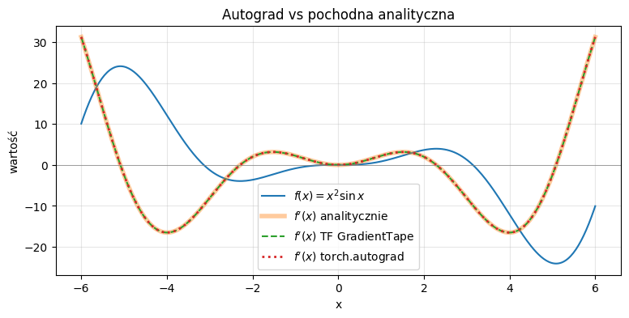

### Zadanie 2.1 - Gradient funkcji dwóch zmiennych w TF i PyTorch
- analitycznie: (0.27105, -0.65559)
- TF: (0.27105, -0.65559)
- PyTorch: (0.27105, -0.65559)

### Zadanie 2.2 - Sprawdzanie gradientu różnicami skończonymi (gradient check)
Pochodną cząstkową przybliżamy różnicą centralną, a jakość sprawdzenia mierzymy błędem względnym:
$$\frac{\partial f}{\partial w_i} \approx \frac{f(\mathbf w + h\mathbf e_i) - f(\mathbf w - h\mathbf e_i)}{2h}, \qquad \mathrm{err} = \frac{\|g_{num} - g_{bp}\|}{\|g_{num}\| + \|g_{bp}\|}.$$

- błąd względny (h = 1e-5) = 1.47e-11

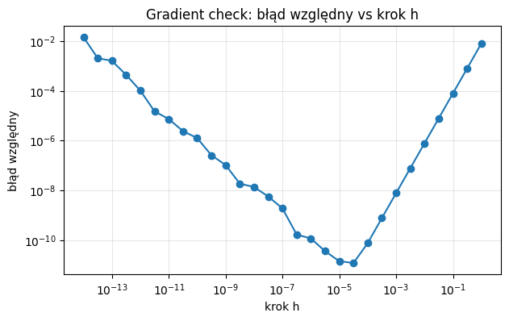

### 3. Regresja liniowa od zera
Model i strata:
$$\hat y = \mathbf w^\top \mathbf x + b, \qquad L(\mathbf w, b) = \frac1n\sum_{i=1}^n(\hat y_i - y_i)^2 .$$
Krok spadku gradientu (full-batch):
$$\mathbf w \leftarrow \mathbf w - \eta\,\frac{2}{n}X^\top(\hat{\mathbf y} - \mathbf y), \qquad b \leftarrow b - \eta\,\frac{2}{n}\sum_{i=1}^n(\hat y_i - y_i).$$

- GD: w = 2.5128, b = -1.0130, MSE = 0.9589
- `polyfit`: w = 2.5128, b = -1.0130

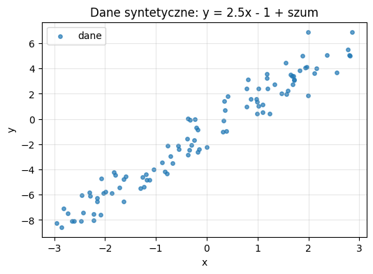

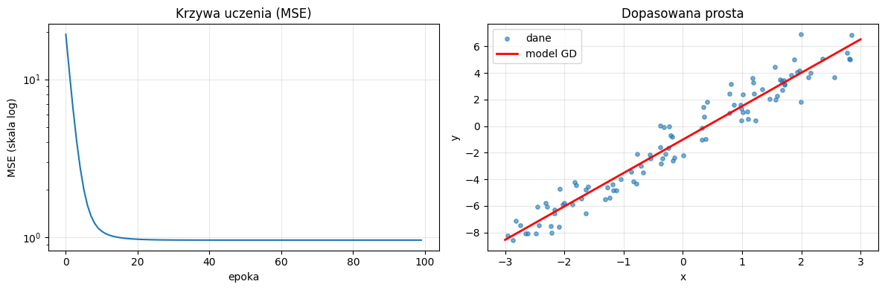

### 3.2 Powierzchnia straty i trajektoria spadku gradientu

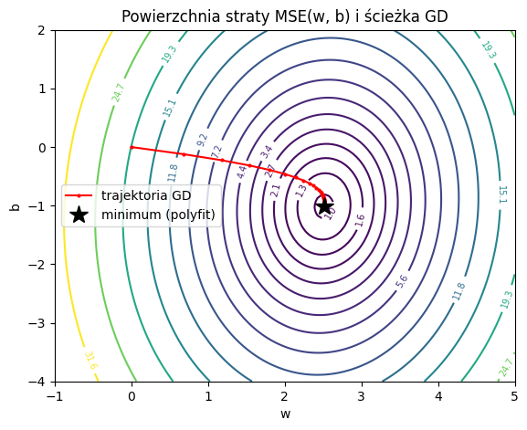

### 3.3 Prawdziwe dane: California Housing
- cechy: MedInc, HouseAge, AveRooms, AveBedrms, Population, AveOccup, Latitude, Longitude
- X: (2000, 8), y: (2000,); train: (1600, 8), test: (400, 8); standaryzacja na statystykach zbioru treningowego
- baseline (średnia): MSE test = 0.9137
- najmniejsze kwadraty (odniesienie): MSE train = 0.2818, test = 0.241

### Zadanie 3.1 - Wektorowy spadek gradientu w NumPy (wiele cech)
- GD (50 epok, lr = 0.2): czas 0.03 s, MSE train = 0.2829 vs optimum = 0.2818 (0.37%)
- MSE test GD = 0.2371
- `max|w_gd - w_ls| = 0.1456`

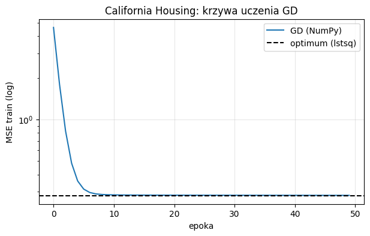

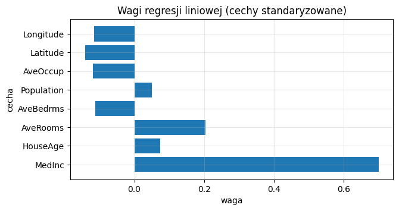

### 3.4 Ta sama regresja w PyTorch - najpierw "ręcznie" z autograd
- PyTorch (autograd): MSE train = 0.2829, `max|w_torch - w_ls| = 0.1456`

### 3.5 ...i w "standardowym" stylu PyTorch: `nn.Linear` + optymalizator
- `nn.Linear` + SGD: MSE train = 0.2859, test = 0.2344

### Zadanie 3.2 - Regresja liniowa w TensorFlow z `GradientTape`
- MSE train: NumPy 0.28288 | PyTorch 0.28288 | TF 0.28288

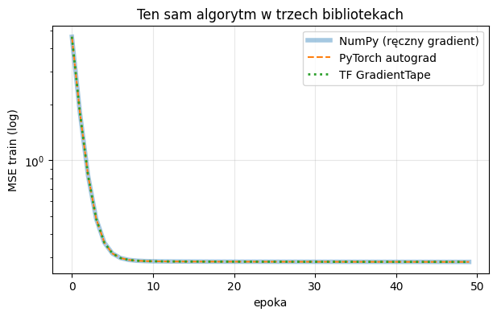

### Zadanie 4.1 - Eksperyment: za mały, dobry i za duży learning rate
Dla MSE hesjan względem parametrów (z kolumną jedynek $\tilde X = [X, \mathbf 1]$) ma postać
$$H = \frac{2}{n}\tilde X^\top \tilde X,$$
a GD jest zbieżny, gdy $\eta < 2/\lambda_{max}(H)$.

- `lambda_min = 0.0480`, `lambda_max = 4.3339`, uwarunkowanie = 90.3
- `lr_kryt = 2/lambda_max = 0.4615`
- `lr = 0.4522` (0.98 * lr_kryt): zbieżność w 8 epokach do 1% od optimum
- `lr = 0.4846` (1.05 * lr_kryt): rozbieżność (MSE = 2.967) - hipoteza o progu `2/lambda_max` potwierdzona doświadczalnie

| lr | MSE po ostatniej epoce | epoki do 1% od optimum |
|---|---|---|
| 0.001 | 3.98 | nie osiągnięto |
| 0.01 | 1.155 | nie osiągnięto |
| 0.1 | 0.2837 | 24 |
| 0.2307 | 0.2830 | 10 |
| 0.4522 | 0.2824 | 8 |
| 0.4846 | 2.967 | nie osiągnięto |

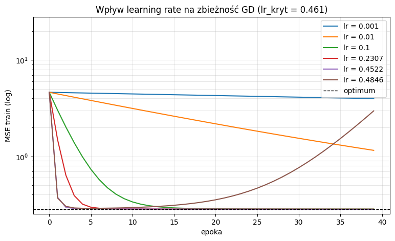

### Zadanie 5.1 - Implementacja mini-batch SGD i porównanie rozmiarów batcha
Gradient na mini-batchu $B$ jest estymatorem gradientu pełnego:
$$\mathbf g_B = \frac{2}{|B|}\sum_{i\in B}(\hat y_i - y_i)\,\mathbf x_i .$$

- 4 epoki, lr = 0.05
- B = 16: MSE = 0.3558
- B = 64: MSE = 0.2928
- B = 256: MSE = 0.2974
- full-batch: MSE = 2.1097 (przy tak małym lr i 4 epokach jeszcze daleko od zbieżności)

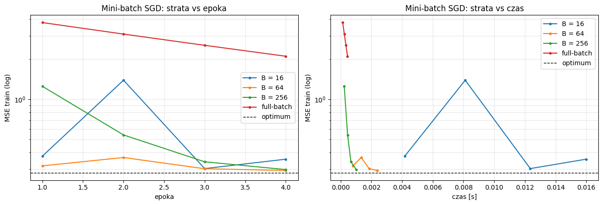

### 5.1 Mini-batche "po bibliotecznemu": `DataLoader` w PyTorch
- `DataLoader` + SGD (B = 64): MSE train = 0.4828

### 6. Regresja wielomianowa i przeuczenie (overfitting)

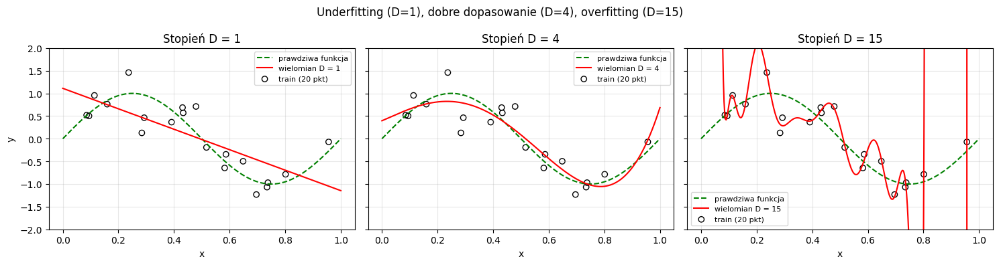

### Zadanie 6.1 - Krzywa train vs walidacja w funkcji stopnia wielomianu
Model wielomianowy jest liniowy względem parametrów:
$$\hat y = \sum_{d=0}^{D} w_d x^d = \mathbf w^\top \phi(x), \qquad \phi(x) = [1, x, x^2, \dots, x^D].$$

- najlepszy stopień wg walidacji: D = 3, MSE val = 0.0911

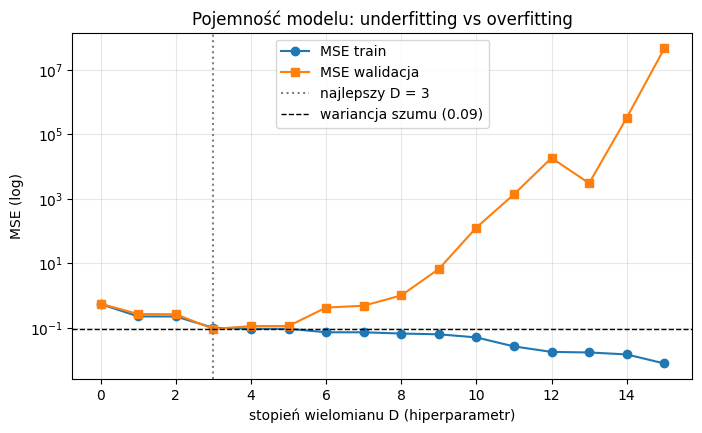

### Zadanie 6.2 - Regularyzacja L2 (ridge) jako "lekarstwo" na przeuczenie
Rozwiązanie analityczne z karą L2:
$$\mathbf w_\lambda = (\Phi^\top\Phi + n\lambda D)^{-1}\Phi^\top\mathbf y, \qquad D = \mathrm{diag}(0, 1, \dots, 1).$$
Macierz $D$ zeruje karę dla biasu - w kodzie korygowany jest element $[0,0]$, więc karane są tylko współczynniki przy cechach.

- najlepsza `lambda = 3.16e-05`, MSE val = 0.1050

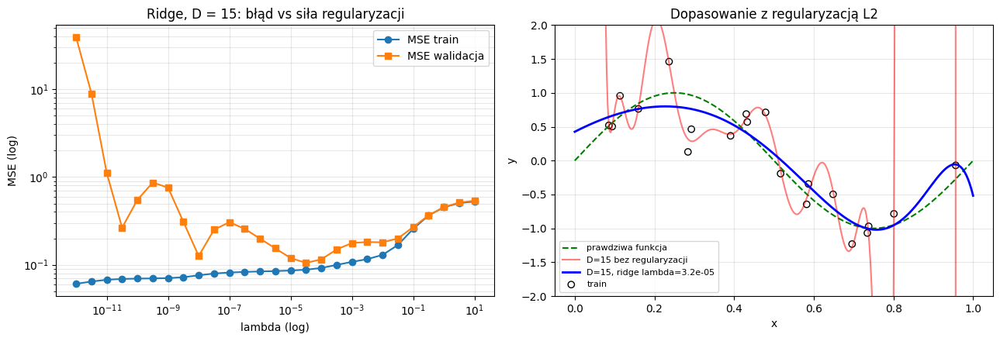

### Zadanie dodatkowe (dla chętnych) - GD, momentum i Adam na funkcji Rosenbrocka
Funkcja testowa ma minimum w $(1, 1)$:
$$f(x, y) = (1 - x)^2 + 100(y - x^2)^2 .$$

- start (-1.5, 2), 300 kroków
- odległość od minimum (1,1): GD (lr=1e-3) = 2.314, momentum (lr=2e-4) = 2.046, Adam (lr=0.02) = 2.065
- momentum (lr=1e-3) = 0.384 (najbliżej minimum)

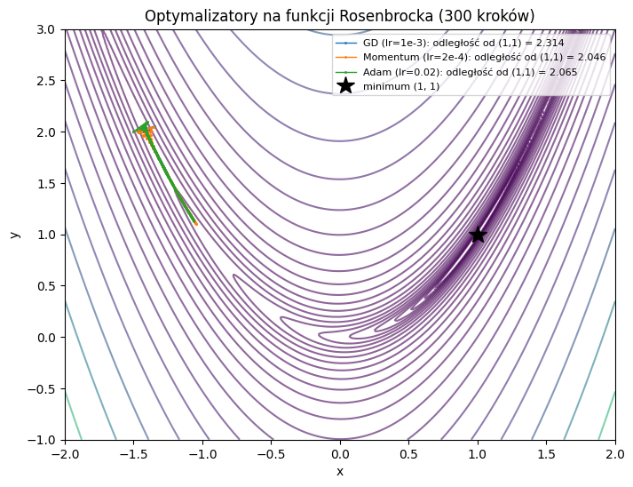

### Wnioski (Lab 01)
- Poprawność implementacji weryfikowano liczbowo: kontrolowano kształty i typy tensorów pośrednich, a ręcznie wyprowadzony gradient porównano z różnicami centralnymi w `float64` (błąd względny `1.5e-11`). Wektoryzowaną macierz odległości zestawiono z wersją pętlową - wyniki zgodne, a czas skrócony z 0.120 s do 0.00614 s (ok. 20x).
- Standaryzacja cech na statystykach zbioru treningowego poprawiła uwarunkowanie zadania (`cond = 90.3`), dzięki czemu GD z learning rate bliskim `lr_kryt` osiągał zbieżność w kilka epok.
- Learning rate okazał się najważniejszym hiperparametrem: wartości znacznie poniżej `lr_kryt` nie dawały zbieżności w zadanym budżecie epok, wartości w pobliżu `lr_kryt` dawały zbieżność najszybciej, a przekroczenie progu `2/lambda_max` prowadziło do rozbieżności - zgodnie z teorią dla straty kwadratowej.
- Pojemność modelu steruje kompromisem między niedouczeniem a przeuczeniem: krzywa walidacyjna ma minimum dla stopnia D = 3, a powyżej niego błąd walidacji rośnie przy wciąż malejącym błędzie treningowym. Stopień wybierano na zbiorze walidacyjnym, a zbiór testowy posłużył do jednorazowej oceny - błąd treningowy nie może być kryterium wyboru, ponieważ maleje monotonicznie wraz z pojemnością.
- Regularyzacja L2 poprawiła dopasowanie modelu o dużej pojemności (D = 15); optymalna wartość współczynnika wyniosła `lambda = 3.16e-05`.
- Przy stałym learning rate mini-batch SGD wykonywał więcej, tańszych kroków na epokę i szybciej zmniejszał błąd niż gradient pełny; trening na całym zbiorze okazał się w tym budżecie najwolniejszy.

## Lab 02

### 0. Środowisko i tryb pracy
- `SZYBKI_TRYB = False` (tryb pełny)
- NumPy 2.2.6, TensorFlow 2.21.0 / Keras 3.12.4, PyTorch 2.14.1+cpu
- GPU niewidoczne (`brak GPU`), `DEVICE = cpu`
- ustawione seedy: `SEED = 42` (Python, NumPy, TensorFlow, PyTorch)

### Zadanie 1.1 - Perceptron od zera w NumPy
- dane: 200 próbek `make_blobs`, 2 cechy, po 100 próbek w każdej klasie
- zbieżność po 2 epokach: błędy `[1, 0]`, dokładność = 1.000
- wyuczone parametry: `w = [0.196, 0.302]`, `b = -0.100`

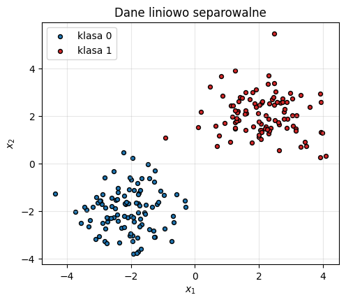

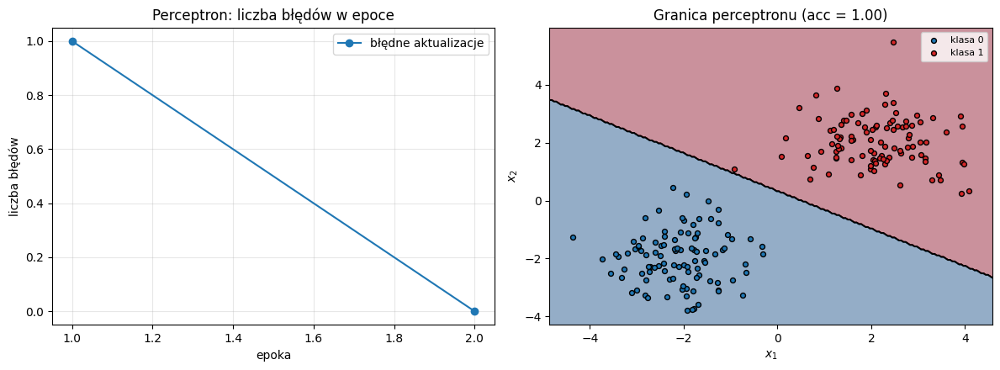

### Zadanie 1.2 - Porażka perceptronu na XOR
- XOR (4 punkty): dokładność = 0.50, błędy w ostatnich epokach `[1, 2, 2, 4, 2]` - nie znikają
- XOR zaszumiony (400 punktów): dokładność = 0.53
- perceptron może narysować tylko jedną prostą, a klasy XOR leżą naprzemiennie na przekątnych kwadratu - żadna prosta ich nie rozdziela

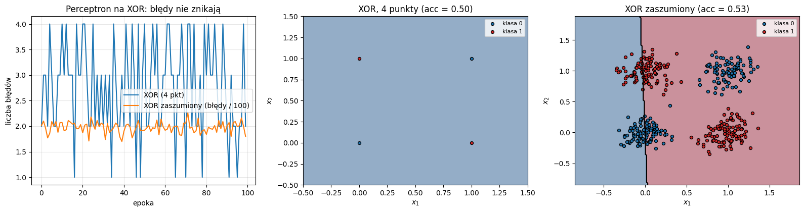

### Zadanie 2.1 - Pochodne funkcji aktywacji: ręcznie vs autograd
- maksymalne różnice względem autogradu PyTorch (`float64`): sigmoid `5.55e-17`, tanh `2.70e-16`, ReLU `0`, LeakyReLU `0`, GELU `2.22e-16`
- wszystkie różnice < 1e-6 - implementacje pochodnych poprawne
- maksimum pochodnej sigmoidu wynosi 0.25 (w `z = 0`); sigmoid i tanh nasycają się dla `|z| > 4`

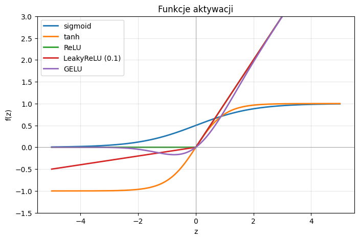

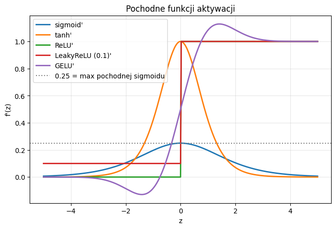

### Zadanie 2.2 - Znikający gradient w 20-warstwowej sieci
- sigmoid: `|grad|` warstwy 1 = `2.47e-13`, warstwy ostatniej = `3.27`, stosunek = `7.5e-14`
- tanh: `1.51e-01` -> `2.67e-01`, stosunek = `5.6e-01`
- ReLU (He): `3.52e-01` -> `2.55e-01`, stosunek = `1.4`
- gradient sigmoidu maleje o ok. 13 rzędów wielkości w stronę wejścia; dla ReLU pozostaje stabilny - hipoteza potwierdzona

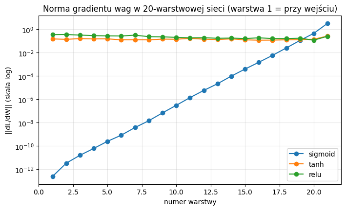

### Zadanie 3.1 - Ręczny backprop i trening MLP na XOR
- architektura 2-4-1, łącznie 17 parametrów
- strata BCE przed treningiem = 0.6712, po 5000 epokach = 0.00047
- predykcje: `[0.000, 0.999, 0.999, 0.001]` -> `[0, 1, 1, 0]` (zgodne z celem)
- granica decyzyjna oddziela przekątne kwadratu

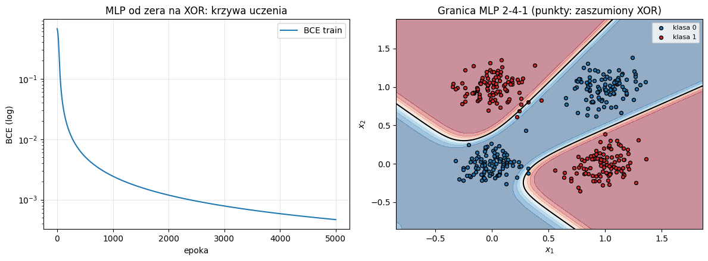

### Zadanie 3.2 - Gradient check ręcznego backpropu
- błędy względne (`h = 1e-5`): `W1 = 7.77e-11`, `b1 = 2.91e-11`, `W2 = 2.96e-11`, `b2 = 2.70e-11`
- wszystkie < 1e-7 - backprop zgodny z różnicami centralnymi

### Zadanie 4.1 - Ręczne liczenie liczby parametrów
- `model_seq` [2, 16, 16, 1]: ręcznie `[48, 272, 17]`, suma 337; Keras `[48, 272, 17]`, 337
- `model_duzy` [2, 64, 32, 8, 1]: ręcznie `[192, 2080, 264, 9]`, suma 2545; Keras identycznie
- `Dense(512)` na spłaszczonym obrazie 28x28: `(784 + 1) * 512 = 401920` parametrów

### 4.2 MLP w Keras: Sequential API (`make_moons`)
- dane: 750 próbek treningowych, 250 walidacyjnych (`noise = 0.2`)
- model 2-16-16-1, Adam (lr = 0.01), 150 epok, batch 32
- czas treningu 17.3 s; walidacja: BCE = 0.0460, dokładność = 0.9800
- krzywe train/walidacja blisko siebie, brak silnego przeuczenia; granica gładko podąża za półksiężycami

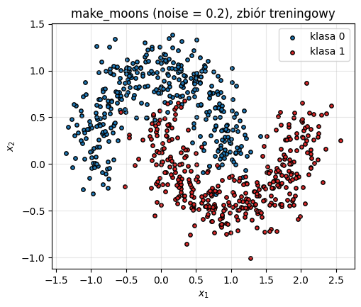

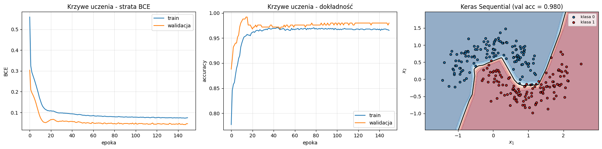

### Zadanie 4.2 - Functional API (`make_circles`)
- model 2-16-8-1 z aktywacją tanh, Adam (lr = 0.01), 150 epok
- dokładność walidacyjna = 0.9880; granica decyzyjna ma kształt zbliżony do okręgu

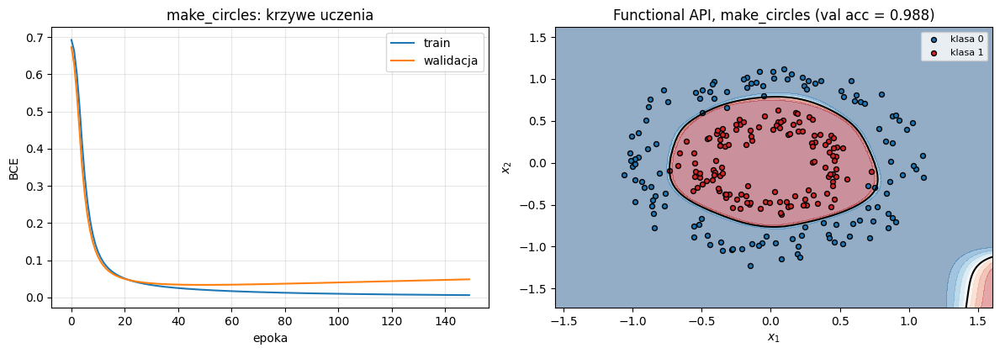

### Zadanie 5.1 - Ten sam MLP w PyTorch
- klasa `MLP` (2-16-16-1) ma 337 parametrów - tyle samo co model Keras
- `BCEWithLogitsLoss` na logitach, Adam (lr = 0.01), 150 epok, `DataLoader` (batch 32)
- czas treningu 4.4 s; walidacja: BCE = 0.0356, dokładność = 0.9880
- wynik porównywalny z Keras (0.9800); krzywe uczenia mają podobny przebieg

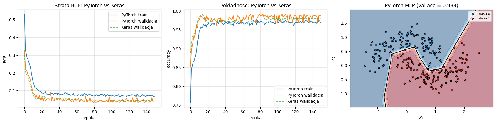

### Zadanie 6.1 - Pojemność sieci a granica decyzyjna
- dane: 200 próbek treningowych i 1000 walidacyjnych, `make_moons` z `noise = 0.3`
- trening full-batch, Adam (lr = 0.01), 2000 kroków

| warstwy x neurony | parametry | train acc | val acc |
|---|---:|---:|---:|
| 1 x 2 | 9 | 0.850 | 0.851 |
| 1 x 8 | 33 | 0.925 | **0.910** |
| 1 x 64 | 257 | 0.950 | 0.900 |
| 2 x 2 | 15 | 0.925 | 0.904 |
| 2 x 8 | 105 | 0.935 | 0.899 |
| 2 x 64 | 4417 | 1.000 | 0.891 |
| 3 x 2 | 21 | 0.875 | 0.848 |
| 3 x 8 | 177 | 0.970 | 0.887 |
| 3 x 64 | 8577 | 0.995 | 0.892 |

- najlepsza architektura wg walidacji: **1 warstwa x 8 neuronów**, val acc = 0.910
- sieć 1 x 2 daje prawie liniową granicę (niedouczenie), a duże modele (2 x 64, 3 x 64) osiągają train acc 1.00 przy val ok. 0.89 (przeuczenie)

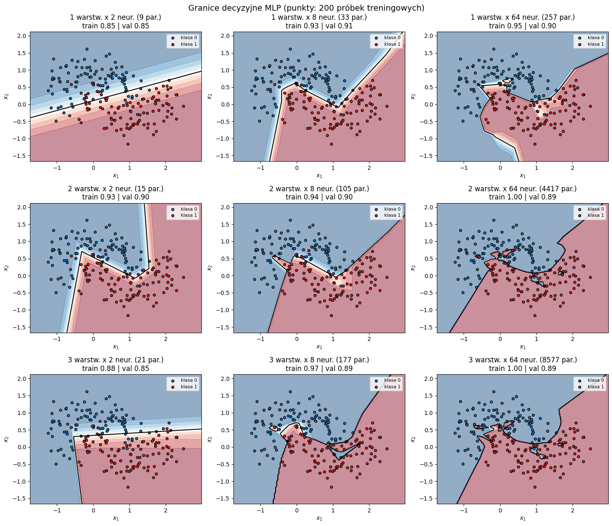

### Zadanie dodatkowe - Uniwersalny MLP w NumPy (spirala)
- sieć [2, 64, 64, 3], ReLU + stabilny softmax, full-batch, lr = 0.5, 5000 iteracji
- dokładność treningowa = 0.993, końcowa entropia krzyżowa = 0.0169
- granice decyzyjne trzech klas podążają za ramionami spiral

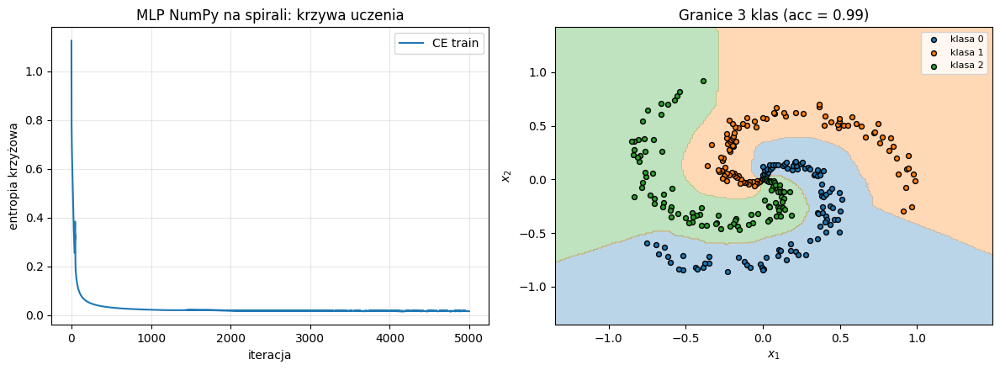

### Wnioski (Lab 02)
- Perceptron uczy się tylko danych liniowo separowalnych: na `make_blobs` osiągnął 100% po 2 epokach, a na XOR utknął na 50-53%, mimo 100 epok. To potwierdza geometryczne ograniczenie pojedynczej hiperpłaszczyzny i potrzebę warstwy ukrytej.
- Nieliniowa aktywacja jest niezbędna: dopiero MLP 2-4-1 z tanh nauczył się XOR (BCE 0.00047, predykcje `[0, 1, 1, 0]`). Ręcznie wyprowadzony backprop zweryfikowano gradient checkiem - błędy względne rzędu `1e-11`.
- Eksperyment z 20 warstwami potwierdził znikający gradient: dla sigmoidu norma gradientu pierwszej warstwy była ok. `7.5e-14` razy mniejsza niż ostatniej, dla tanh stosunek wynosił 0.56, a dla ReLU z inicjalizacją He - 1.4. ReLU i inicjalizacja He są praktycznym standardem w głębokich sieciach.
- Implementacje NumPy, Keras i PyTorch są spójne: liczba parametrów zgadza się co do jednego (337 dla 2-16-16-1, 2545 dla 2-64-32-8-1), a modele Keras i PyTorch osiągnęły zbliżoną dokładność walidacyjną (0.980 vs 0.988).
- Pojemność steruje kompromisem niedouczenie/przeuczenie: zbyt mała sieć (1 x 2) ma granicę prawie liniową, a duże modele na 200 próbkach przeuczają się (train 1.00, val ok. 0.89). Architekturę wybrano na zbiorze walidacyjnym - najlepsza okazała się 1 x 8 (val 0.910), a nie największa sieć.
- Zadanie dodatkowe pokazało, że ręczny backprop uogólnia się na wiele klas i dowolną liczbę warstw: sieć NumPy [2, 64, 64, 3] osiągnęła 99.3% na spirali, bez użycia autogradu.

## Lab 03

### 0. Środowisko i tryb pracy
- `SZYBKI_TRYB = False` (tryb pełny), `SEED = 42` (`keras.utils.set_random_seed`)
- NumPy 2.2.6, TensorFlow 2.21.0 / Keras 3.12.4 (backend `tensorflow`), scikit-learn 1.7.2
- brak GPU (`tf.config.list_physical_devices("GPU") == []`) - TensorFlow na natywnym Windowsie nie obsługuje CUDA, wszystkie obliczenia wykonano na CPU
- Fashion-MNIST: 50 000 / 10 000 / 10 000 (train / val / test), piksele przeskalowane do [0, 1]
- California Housing: 20 640 rekordów -> 12 384 / 4 128 / 4 128; `StandardScaler` dopasowany **tylko** na zbiorze treningowym

### 1. Trening demonstracyjny (MLP 784-128-10)
Najprostsza sieć: `Flatten(784) -> Dense(128, relu) -> Dense(10, softmax)`, 101 770 parametrów, Adam (lr = 1e-3), 10 epok, batch 128.

- czas treningu: 18.4 s (CPU); `accuracy` treningowa 0.9045, walidacyjna 0.8817, `val_loss` 0.3428 (minimum w ostatniej epoce)
- `predict` zwraca rozkłady prawdopodobieństw - suma w każdym wierszu = 1.0, więc `argmax` daje klasę o największym prawdopodobieństwie

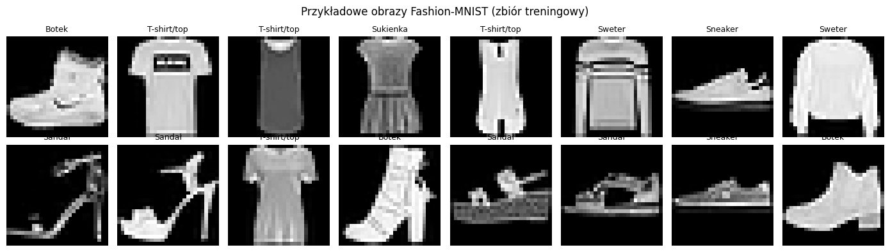

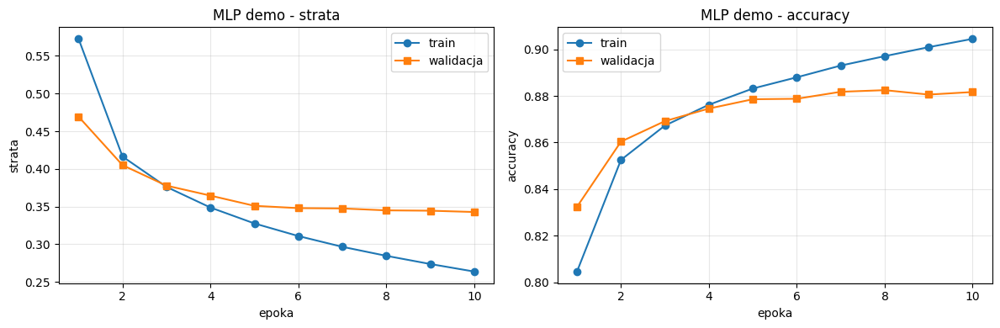

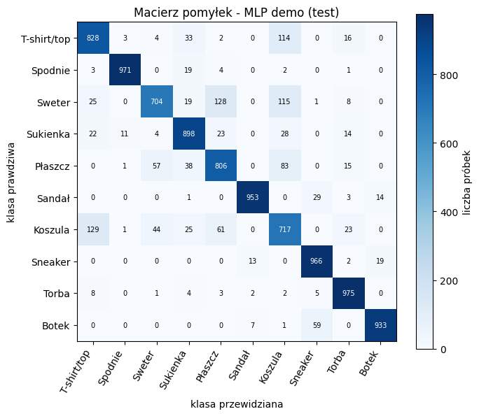

### Zadanie 1.1 - Głębszy MLP na Fashion-MNIST
Architektura `784 -> 256 -> 128 -> 10`, Adam (lr = 1e-3), `sparse_categorical_crossentropy`, 15 epok, batch 128, walidacja na wydzielonej 1/6 części treningu.

- czas treningu: 33.3 s (CPU)
- dokładność walidacyjna (ostatnia epoka) = **0.8843**, testowa = **0.8754** (test loss = 0.3940)
- minimum `val_loss` wypada w epoce **8** (0.3496); potem strata walidacyjna rośnie do 0.3750 w epoce 15, choć treningowa nadal spada (0.247 -> 0.1785). Luka `accuracy - val_accuracy` w ostatniej epoce to 0.050, a `accuracy` treningowa dochodzi do 0.934 - to początek przeuczenia
- liczba parametrów: ręcznie $784\cdot256+256 = 200\,960$, $256\cdot128+128 = 32\,896$, $128\cdot10+10 = 1\,290$; suma **235 146** = `model_mlp.count_params()`

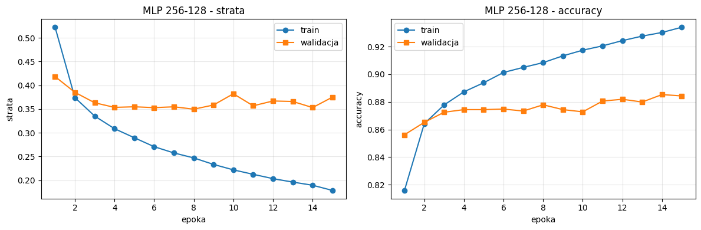

### Zadanie 1.2 - Analiza błędów
Dokładność per klasa (test): Spodnie 0.983, Torba 0.983, Sneaker 0.975, Botek 0.931, Sandał 0.926, Sukienka 0.900, Płaszcz 0.819, T-shirt/top 0.813, Koszula 0.746, **Sweter 0.678**.

- najczęściej mylona para: **T-shirt/top -> Koszula** (139 próbek); dalej Sweter/Płaszcz oraz Koszula/T-shirt
- przyczyny: Koszula i T-shirt to cienkie, podobnie zarysowane fasony o jasnych pikselach, a Sweter i Płaszcz dzielą gruby, bezrękawny kształt. Po `Flatten` do 784 cech model nie widzi lokalnych detali (kołnierzyk, guziki, ściągacz rękawa), więc myli klasy różniące się głównie nimi - stąd najgorsze wyniki dla Koszuli i Swetra

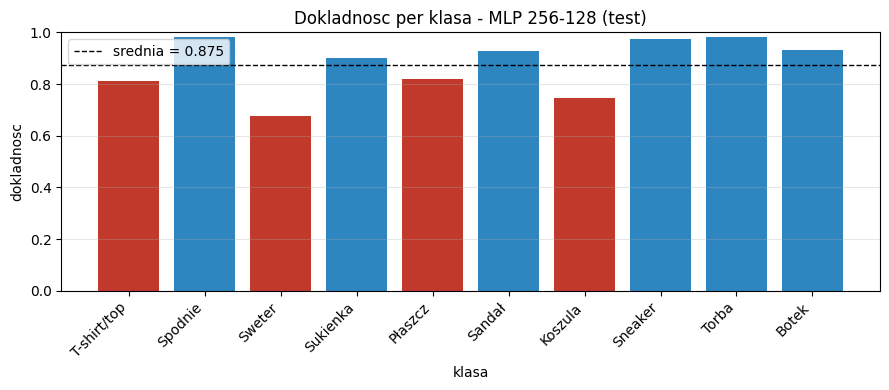

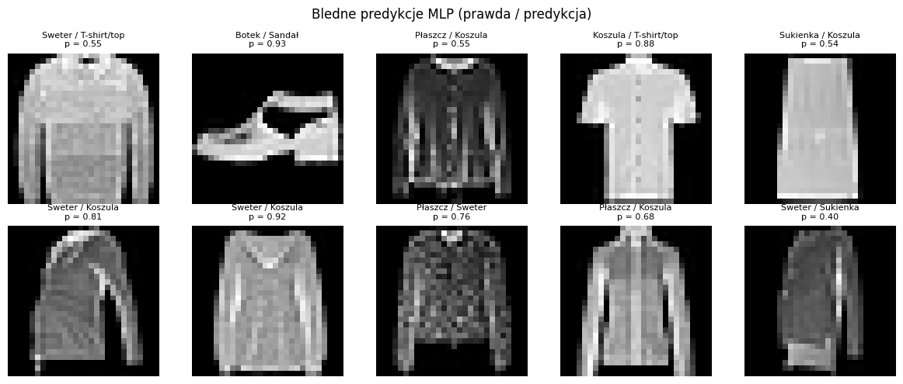

### Zadanie 2.1 - Baseline liniowy
- baseline średniej: MAE = 0.905, RMSE = 1.145 (jednostka: 100 tys. $)
- regresja liniowa: MAE = **0.533**, RMSE = **0.750**, czyli 41.1% mniej MAE niż baseline i wartości zgodne z oczekiwanymi (ok. 0.53)
- na cechach standaryzowanych największe znaczenie mają `MedInc` (+0.860) oraz położenie: `Latitude` (-0.888) i `Longitude` (-0.862)

### Zadanie 2.2 - Sieć do regresji
Model `8 -> 64 -> 64 -> 1` (wyjście liniowe), Adam (lr = 1e-3), strata MSE, metryka MAE, 60 epok, batch 64.

| model | MAE | RMSE |
|---|---:|---:|
| baseline (średnia) | 0.905 | 1.145 |
| regresja liniowa | 0.533 | 0.750 |
| MLP 64-64 | **0.360** | **0.530** |

- czas treningu 29.9 s; wyjście trzeba spłaszczyć `ravel()` - bez tego `y - y_pred` rozgłasza się do macierzy `(n, n)`
- 184 z 4128 próbek testowych ma cenę **uciętą na 5.0** (500 tys. $). Na wykresie widać to jako pionową linię w $x = 5$ i niedoszacowanie najdroższych dzielnic (większość prognoz w 2.7-4.5). To ograniczenie danych, nie modelu: górny przedział jest sztucznie obcięty, więc sieć nie ma z czego nauczyć się wartości powyżej 5

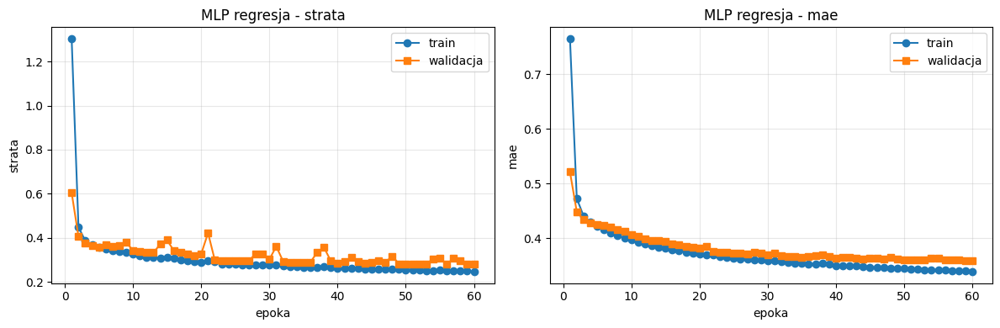

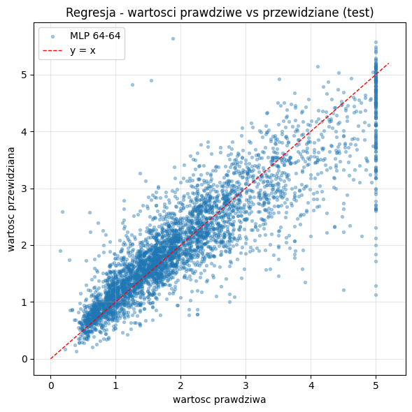

### Zadanie 3.1 - Trzy callbacki naraz
`EarlyStopping(patience=10, restore_best_weights=True)`, `ModelCheckpoint("najlepszy_reg.keras", save_best_only=True)`, `ReduceLROnPlateau(factor=0.5, patience=4, min_lr=1e-5)`.

- trening zatrzymał się po **152 z 200** epok; najlepsza epoka wg `val_loss`: **142**
- learning rate: 1e-3 -> 5e-4 (ep. 10) -> 2.5e-4 (39) -> 1.25e-4 (49) -> 6.25e-5 (58) -> 3.1e-5 (65) -> 1.6e-5 (72) -> 1e-5 (78), dalej `min_lr`
- model wczytany z checkpointu: MAE = **0.365**, RMSE = **0.540** (zad. 2.2: 0.360 / 0.530) - praktycznie ten sam poziom, różnica wynika z wyboru epoki po `val_loss` (MSE), a nie po MAE
- wcześniejsza demonstracja `EarlyStopping` na Fashion-MNIST: 11 z 50 epok, najlepsza epoka 8

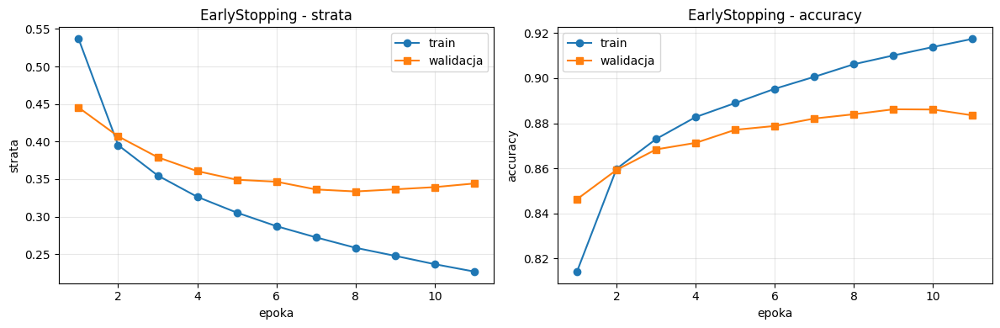

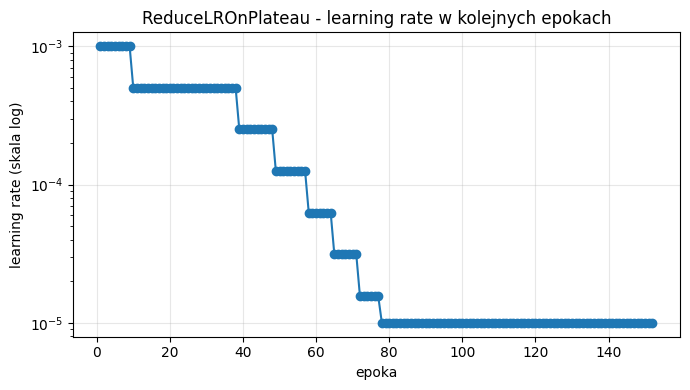

### Zadanie 4.1 - Porównanie optymalizatorów
| optymalizator | najlepsza `val_accuracy` | epoka | `val_loss` (ostatnia) |
|---|---:|---:|---:|
| SGD lr = 0.01 | 0.8354 | 10 | 0.4767 |
| SGD + momentum 0.9, lr = 0.01 | 0.8722 | 9 | 0.3622 |
| RMSprop lr = 0.001 | **0.8859** | 10 | **0.3226** |
| Adam lr = 0.001 | 0.8825 | 8 | 0.3428 |

- SGD bez momentum jest wyraźnie najsłabszy: pojedynczy krok o stałej długości bez wygładzania oscylacji w "wąskich dolinach" funkcji straty
- momentum 0.9 wyraźnie przyspiesza (0.8354 -> 0.8722), a metody adaptacyjne (RMSprop, Adam) osiągają najlepsze wyniki już po kilku epokach

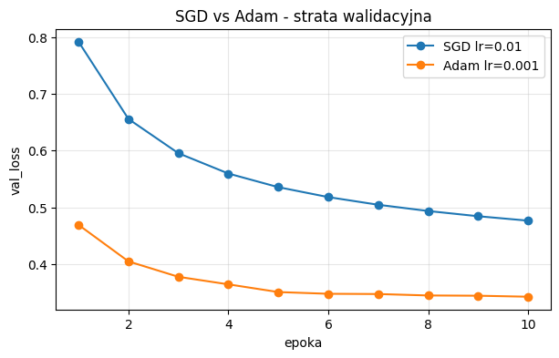

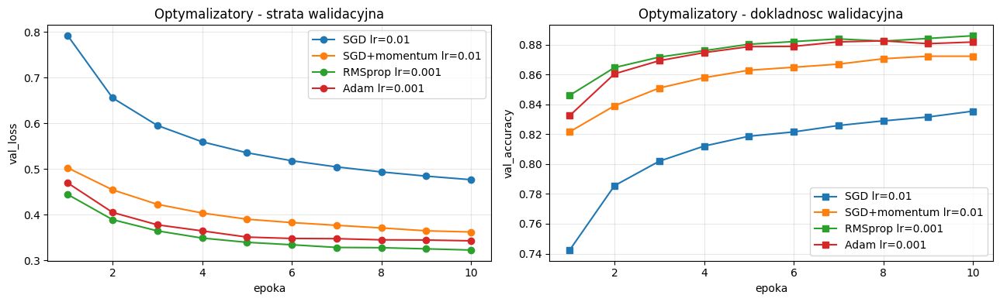

### Zadanie 4.2 - Wpływ learning rate (Adam)
| lr | strata treningowa (ost.) | `val_accuracy` (ost.) | interpretacja |
|---:|---:|---:|---|
| 1e-4 | 0.3917 | 0.8552 | za mały - bardzo wolny spadek |
| 1e-3 | **0.2638** | **0.8817** | najlepszy kompromis |
| 1e-2 | 0.2994 | 0.8662 | lekko za duży - gorsze minimum |
| 1e-1 | 0.9790 | 0.6064 | stanowczo za duży - oscylacje, brak zbieżności |

Przy 0.1 strata w pierwszych epokach skacze i utyka na ok. 1.0; żaden wariant nie dał `nan`, ale widać już obraz rozbieżności.

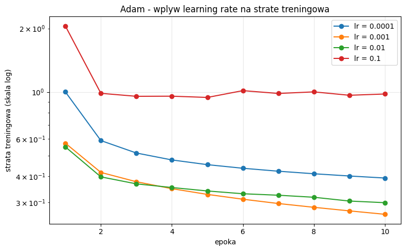

### 5. Celowe przeuczenie i regularyzacja
Sieć `784 -> 3 x 512 -> 10` (932 362 parametry), trening na 1000 obrazów, 60 epok: `accuracy` treningowa **0.996**, walidacyjna **0.815**, minimum `val_loss` już w epoce 6 (0.5954), potem strata walidacyjna rośnie - klasyczne przeuczenie.

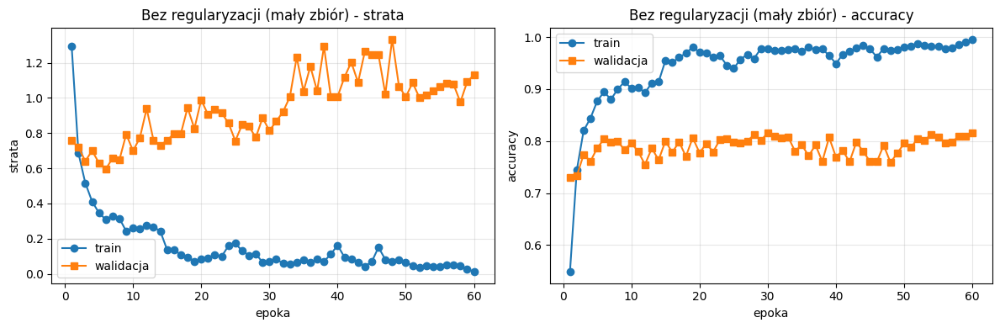

### Zadanie 5.1 - Dropout i L2
- Dropout 0.5: train 0.914 / val 0.8147, luka **0.099**, min `val_loss` 0.5875 (ep. 12)
- L2 $\lambda = 10^{-3}$: train 0.964 / val 0.7859, luka 0.178, min `val_loss` 1.0605 (ep. 54)
- L2 działa, ale $\lambda = 10^{-3}$ jest za duże dla tej sieci; dodatkowo kara $\lambda\sum w^2$ jest doliczana do raportowanej straty, więc jej `val_loss` nie jest wprost porównywalny z pozostałymi - porównujemy `accuracy` i lukę

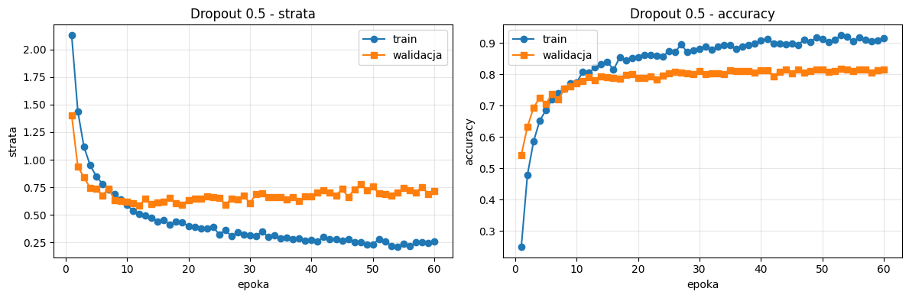

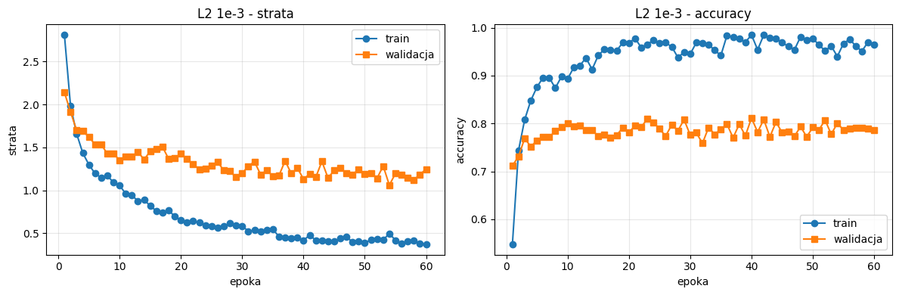

### Zadanie 5.2 - BatchNormalization i zestawienie

| wariant | najlepsza `val_accuracy` | `val_accuracy` (ost.) | `accuracy` train (ost.) | luka train-val | min `val_loss` | epoka |
|---|---:|---:|---:|---:|---:|---:|
| bez regularyzacji | 0.8158 | 0.8151 | 0.996 | 0.181 | 0.5954 | 6 |
| Dropout 0.5 | **0.8181** | 0.8147 | 0.914 | **0.099** | 0.5875 | 12 |
| L2 1e-3 | 0.8114 | 0.7859 | 0.964 | 0.178 | 1.0605 | 54 |
| BatchNorm | 0.8114 | 0.8098 | 1.000 | 0.190 | 0.6896 | 10 |
| BatchNorm + Dropout 0.3 | 0.8120 | 0.7992 | 0.992 | 0.193 | 0.6247 | 7 |

**Hipoteza (przed uruchomieniem):** BatchNorm najbardziej przyspieszy spadek `val_loss` (stabilizacja aktywacji), ale słabiej niż Dropout ograniczy przeuczenie; największą lukę train-val powinien mieć wariant BN, a najmniejszą Dropout.

**Weryfikacja:** częściowo potwierdzona. Luka train-val rzeczywiście układa się zgodnie z hipotezą (BN 0.190 i BN+Dropout 0.193 > bez regularyzacji 0.181 > Dropout 0.099). Nie potwierdziło się natomiast przyspieszenie: BN nie poprawił `val_accuracy` (0.811 vs 0.815), a jego `val_loss` w pierwszych 20 epokach jest bardzo niestabilny (skoki do 1.6-2.0); wariant łączony też nie połączył zalet. Na płytkim MLP i małym zbiorze skuteczną regularyzacją okazał się Dropout.

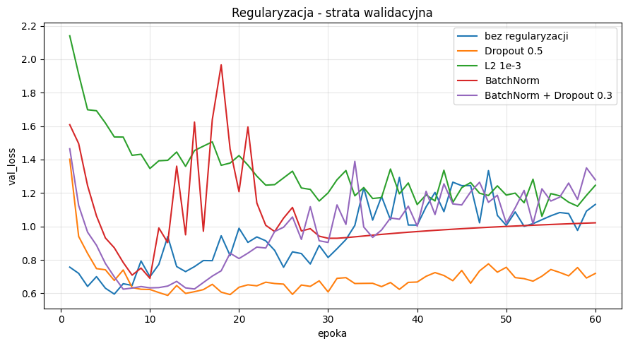

### Zadanie 6.1 - Zapis wag i wznowienie treningu
- `wagi_dropout.weights.h5`: nowy model zbudowany tą samą funkcją + `load_weights` daje **identyczne** predykcje (`np.allclose` = `True`), bo Dropout w `predict` jest wyłączony
- `model_dropout.keras` (1215.2 kB) zawiera architekturę, wagi i optymalizator (`Adam`); po wczytaniu trening wznowiono bez `compile`: `val_accuracy` 0.6325 -> **0.7082**, `val_loss` 0.9400 -> 0.7701 po 2 epokach

### Zadanie dodatkowe - własny callback i CosineDecay
- `ZatrzymajPrzyDokladnosci(prog=0.89)` zapisuje learning rate i przerywa trening po przekroczeniu progu; optymalizator Adama z harmonogramem `CosineDecay(1e-3, decay_steps = 20 x 391)`
- trening zatrzymał się po **11 z 20** epok przy `val_accuracy` = **0.8904**; lr zmalał z 9.94e-4 do 4.22e-4
- próg 0.89 osiągnięto szybciej niż w zad. 1.1 (tam 0.8843 po 15 epokach) - harmonogram obniża krok pod koniec, co stabilizuje końcową fazę treningu

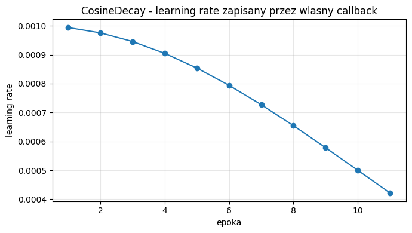

### Wnioski (Lab 03)
- Pełny trening MLP na CPU jest w zasięgu: 15 epok na 50 000 obrazów to 33 s, a cały notebook (klasyfikacja, regresja, callbacki, optymalizatory, regularyzacja) wykonuje się w kilka minut.
- Wysokopoziomowe API Keras sprowadza eksperyment do `compile` / `fit` / `evaluate`, a różnice między wariantami wynikają z hiperparametrów, nie z kodu. Ten sam szkielet posłużył do klasyfikacji (softmax + `sparse_categorical_crossentropy`) i regresji (liniowe wyjście + MSE).
- Krzywe uczenia są podstawową diagnostyką: dla MLP 256-128 minimum `val_loss` wypada w epoce 8, a potem rośnie przy wciąż malejącej stracie treningowej. `EarlyStopping(restore_best_weights=True)` i `ModelCheckpoint` pozwalają zatrzymać trening dokładnie w tym minimum - w zad. 3.1 dało to MAE 0.365 wobec 0.360 bez callbacków.
- Baseline jest obowiązkowy: dopiero na jego tle widać, że sieć wnosi coś ponad prosty model (MAE 0.360 vs 0.533 dla regresji liniowej i 0.905 dla średniej). Standaryzacja dopasowana tylko na train nie zaburza oceny: średnie cech na zbiorze testowym nie są zerowe, co potwierdza, że statystyki nie wyciekły z testu do treningu.
- Learning rate to najważniejszy hiperparametr: 1e-4 daje wolny spadek, 1e-3 optimum, a 0.1 rozbieżność (`val_accuracy` 0.606). Wśród optymalizatorów SGD bez momentum jest najsłabszy (0.8354), a metody adaptacyjne osiągają 0.88-0.89.
- Regularyzacja działa, ale trzeba dobrać jej siłę: Dropout 0.5 zmniejszył lukę train-val z 0.181 do 0.099, L2 z $\lambda = 10^{-3}$ okazał się zbyt silny (spadek `accuracy`), a BatchNorm bez warstw konwolucyjnych nie poprawił wyniku - jego główna rola (stabilizacja treningu) ujawnia się w głębszych sieciach.
- Model jest elementem cyklu życia: zapis wag i pełnego modelu działa (`np.allclose` = `True`), a wczytany model można trenować dalej bez ponownego `compile` (val 0.6325 -> 0.7082).

### Propozycja usprawnienia (UGŁ_U02)
Największy zysk dałaby **augmentacja danych + early stopping** dla klasyfikacji: odbicia poziome i niewielkie przesunięcia/obroty zwiększają efektywną liczebność zbioru, co bezpośrednio adresuje lukę train-val 0.05 i mylenie Koszuli z T-shirtem. Równolegle warto zastąpić ręczny `ReduceLROnPlateau` harmonogramem `CosineDecay` z `AdamW(weight_decay=1e-4)` - regularyzacja L2 w optymalizatorze nie zawyża raportowanej straty i lepiej współpracuje z harmonogramem. Docelowo lokalną strukturę obrazu (szwy, kołnierzyk, faktura) powinny wychwycić warstwy konwolucyjne - temat Lab 04.

## Lab 04

### 0. Środowisko i tryb pracy
- `SZYBKI_TRYB = False` (tryb pełny), `SEED = 42` (`keras.utils.set_random_seed`)
- TensorFlow 2.21.0 / Keras 3.12.4 (backend `tensorflow`); brak GPU (`tf.config.list_physical_devices("GPU") == []`) - karta RTX 4060 Ti jest w maszynie, ale build TensorFlow dla Windows nie zawiera CUDA (od TF 2.11 nie ma oficjalnego wsparcia GPU na Windows), więc wszystko liczyło się na CPU
- Fashion-MNIST: 50 000 / 10 000 / 10 000 (train / val / test), piksele w [0, 1]; CIFAR-10: 45 000 / 5 000 / 10 000
- transfer learning: podzbiór CIFAR-10 9 000 / 1 000 / 2 000 przy 96x96, surowe obrazy 0-255 i `mobilenet_v2.preprocess_input` wewnątrz modelu
- koszt na CPU: baseline CIFAR-10 395 s (15 epok), `model_cifar` 4 645 s (40 epok), `model_res` 6 253 s (40 epok), transfer 171 s + 220 s; cały notebook ponad 3 h
- notebook wykonał się 24/24 komórek **bez błędów i bez warningów**

### Zadanie 1.2 - Wymiary i parametry "na papierze"
- własna funkcja `splot2d` (pętle, korelacja krzyżowa, stride i padding) daje ten sam wynik co `tf.nn.conv2d`: kształt `(14, 14)`, maksymalna różnica bezwzględna **1.192e-07** (typowy błąd `float32`)
- liczby policzone ręcznie zgadzają się z Kerasem (`zgodne=True` dla każdej warstwy):

| warstwa | kształt wyjścia | parametry |
|---|---|---:|
| `Conv2D(16, 5, valid)` | 28x28x16 | 1 216 |
| `MaxPooling2D(2)` | 14x14x16 | 0 |
| `Conv2D(32, 3, same, strides=2)` | 7x7x32 | 4 640 |
| `Flatten` | 1 568 | 0 |
| `Dense(10)` | 10 | 15 690 |
| **razem** | | **21 546** |

### Zadanie 2.1 - MLP vs CNN na Fashion-MNIST (UGŁ_U01)
CNN: `Conv2D(32, 3) → MaxPool(2) → Conv2D(64, 3) → MaxPool(2) → Flatten → Dense(128) → Dense(10)`, Adam (lr = 1e-3), 12 epok, batch 128.

| model | parametry | test accuracy | czas treningu [s] |
|---|---:|---:|---:|
| MLP 256-128 (Lab 03) | 235 146 | 0.8713 | 21.5 |
| CNN | 421 642 | **0.9097** | 175.4 |

**Hipoteza (przed uruchomieniem):** CNN będzie dokładniejsza (0.91-0.93 wobec 0.88 dla MLP) dzięki lokalności i współdzieleniu wag, ale będzie miała **więcej** parametrów - sploty są tanie (320 + 18 496), natomiast `Dense(128)` po `Flatten` mapy 7x7x64 dokłada 401 536 wag, czyli ok. 421 642 razem.

**Weryfikacja:** potwierdzona we wszystkich trzech punktach, choć dokładność wyszła przy dolnej granicy widełek.

- dokładność: 0.9097 vs 0.8713, czyli **+3.8 p.p.** na korzyść splotu
- parametry: 421 642 vs 235 146, czyli **1.79x więcej** - rachunek z hipotezy zgadza się co do jednego parametru (320 + 18 496 + 401 536), a `Dense(128)` po `Flatten` to **95%** wszystkich wag sieci
- czas: 175.4 s vs 21.5 s (**8x dłużej**) - sploty mają mało parametrów, ale dużo operacji
- czego hipoteza nie przewidywała: CNN zaczyna się lekko przeuczać (`accuracy` 0.9477 vs `val_accuracy` 0.9153 w 12. epoce, minimum `val_loss` już w epoce 7), więc sam splot nie chroni przed zapamiętywaniem

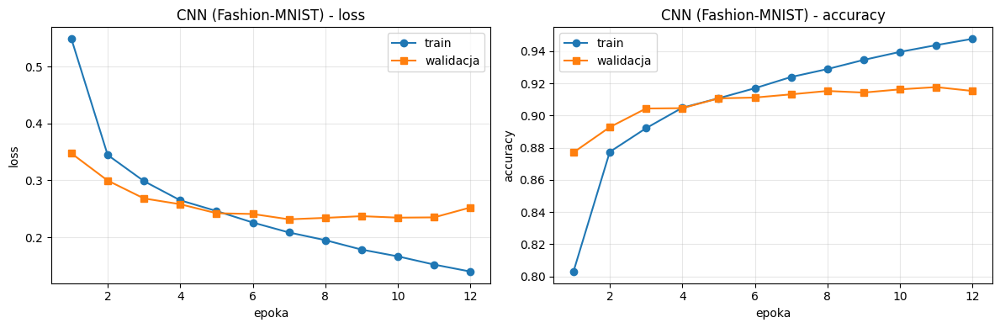

### 3. CIFAR-10: baseline vs BatchNorm + augmentacja
| model | parametry | epoki | czas [s] | test accuracy | luka train-val |
|---|---:|---:|---:|---:|---:|
| baseline (bez BN i augmentacji) | 356 810 | 15 | 395 | 0.7011 | **+0.162** |
| `model_cifar` (BN + augmentacja + Dropout) | 551 914 | 40 | 4 645 | **0.8003** | **-0.018** |

- baseline przeucza się klasycznie: `val_loss` osiąga minimum około 6.-7. epoki (ok. 0.84), a potem rośnie do ok. 1.08, podczas gdy strata treningowa spada dalej (do ok. 0.35); dokładność treningowa dochodzi do 0.88 przy walidacyjnej 0.72
- `model_cifar` jest lepszy o **+9.9 p.p.** i nie widać w nim przeuczenia: luka train-val jest **ujemna** (-0.018), bo augmentacja utrudnia zbiór treningowy (model uczy się na obrazach odbitych lustrzanie, przesuniętych, obróconych i przeskalowanych), a walidacja jest "czysta" - to różnica trudności, nie przeciek danych
- `EarlyStopping(monitor="val_accuracy", patience=6)` **nie zadziałał**: dokładność walidacyjna poprawiała się do ostatniej epoki, a minimum `val_loss` wypadło w epoce 40/40, czyli model wciąż się uczył i 40 epok to raczej dolna granica
- `ReduceLROnPlateau(factor=0.5, patience=3)` obniżył learning rate cztery razy: 1e-3 -> 5e-4 (ep. 26) -> 2.5e-4 (30) -> 1.25e-4 (35) -> 6.25e-5 (39); każde z pierwszych trzech obniżeń podniosło `val_accuracy` o 2-3 p.p. (0.7498 w ep. 24 -> 0.7842 -> 0.8030 -> 0.8128)
- koszt: 551 914 parametrów i 4 645 s zamiast 356 810 i 395 s, ale zysk dokładności jest duży

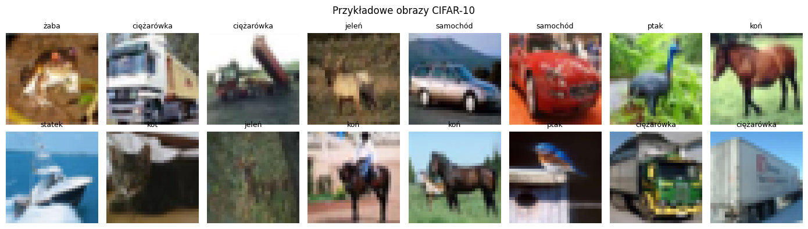

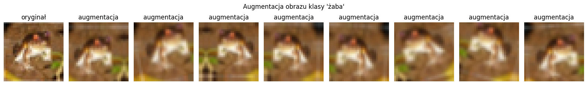

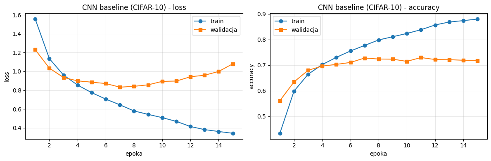

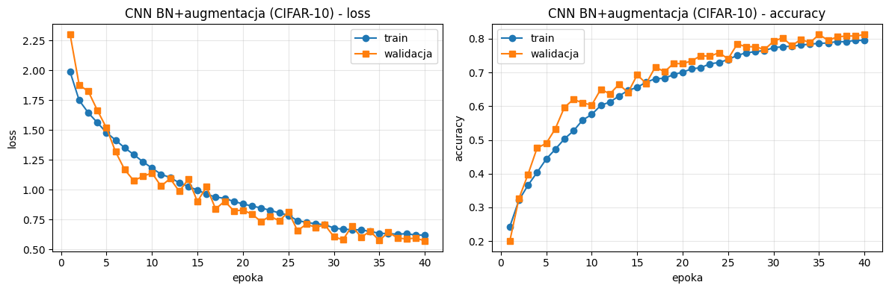

### Zadanie 4.1 - Mini-ResNet i GlobalAveragePooling
- `GlobalAveragePooling2D` zamiast `Flatten` redukuje głowę klasyfikatora z **81 930** do **1 290** parametrów (63x mniej) - mapa 8x8x128 nie jest rozwijana do 8192 liczb
- mini-ResNet: trzy bloki residualne (32, 64 i 128 kanałów, ostatni ze skrótem 1x1 przez `strides=2`), augmentacja na wejściu, GAP + `Dropout(0.2)` na końcu; **309 994** parametry, 6 253 s, test accuracy **0.7952**
- w porównaniu z `model_cifar`: 1.8x mniej parametrów i tylko -0.5 p.p. dokładności testowej, ale **wyższa dokładność treningowa** (0.8269 vs 0.7947) - bloki residualne poprawiają warunki optymalizacji, a nie pojemność modelu
- `val_loss` jest w tym modelu znacznie bardziej nierówny (skoki do 1.37-1.85 w epokach 3-7), co przy `BatchNorm`, lr = 1e-3 i walidacji liczącej 5 000 obrazów oznacza po prostu głośną estymatę; `ReduceLROnPlateau` uspokoił przebieg w drugiej połowie treningu

### Zadanie 5.1 - Mapy cech płytkie vs głębokie
Warstwy splotowe `model_cifar`: `conv_b1_1`, `conv_b1_2`, `conv_b2_1`, `conv_b2_2`, `conv_b3_1`, `ostatni_conv`. Wejście przechodzi przez trzy bloki z `MaxPooling2D(2)`, więc mapa po `conv_b1_1` ma kształt **1x32x32x32**, a po `ostatni_conv` - **1x8x8x128**.

Płytkie mapy pokazują krawędzie, kontury i granice kolorów (u samolotu wyraźnie widać skrzydła, kadłub i linię horyzontu), a każdy kanał wyspecjalizował się w innym kierunku krawędzi. Głębokie mapy to 8x8 rozmytych plam - pojedyncza komórka odpowiada fragmentowi 4x4 pikseli wejścia, a pole recepcyjne `ostatni_conv` obejmuje praktycznie cały obraz, więc kanały kodują już nie detale, a "gdzie w obrazie jest obiekt danej kategorii".

### Zadanie 6.1-6.2 - Transfer learning z MobileNetV2
- baza: 154 warstwy, wyjście `(None, 3, 3, 1280)` dla wejścia 96x96 (rozdzielczość zmniejszona 32x), 2 257 984 parametry i **0 trenowalnych** po zamrożeniu; cały model ma 2 270 794 parametry
- etap 1 (zamrożona baza + nowa głowa GAP-Dropout-Dense): **12 810** trenowalnych parametrów (0.56% modelu), 6 epok, 171 s, test accuracy **0.8315**
- etap 2 (fine-tuning 30 ostatnich warstw bazy, m.in. `Conv_1`, `Conv_1_bn`, `out_relu`): **1 539 210** trenowalnych parametrów, lr = **1e-5**, kolejne 6 epok (`initial_epoch=6`), 220 s, test accuracy **0.8405**
- na starcie etapu 2 widać charakterystyczne "szarpnięcie": w epoce 7 dokładność treningowa spada z 0.876 do 0.782 (walidacyjna 0.859 -> 0.830), ale dzięki małemu lr model odrabia stratę w dwie epoki i kończy na 0.8977 / 0.8620
- sam etap 1 bije modele trenowane od zera: 0.8315 przy 9 000 obrazów i 171 s, wobec 0.8003 dla `model_cifar` (45 000 obrazów, 4 645 s) - choć na mniejszym (2 000-obrazowym) zbiorze testowym

### Zadanie 6.3 - Zestawienie modeli i macierz pomyłek
| model | parametry | test accuracy | obrazy treningowe | test (n) |
|---|---:|---:|---:|---:|
| CNN baseline | 356 810 | 0.7011 | 45 000 | 10 000 |
| CNN BN+aug (3.1) | 551 914 | 0.8003 | 45 000 | 10 000 |
| mini-ResNet (4.1) | 309 994 | 0.7952 | 45 000 | 10 000 |
| MobileNetV2 zamrożona (6.1) | 2 270 794 | 0.8315 | 9 000 | 2 000 |
| MobileNetV2 fine-tuning (6.2) | 2 270 794 | **0.8405** | 9 000 | 2 000 |

Uwaga: dwa ostatnie wiersze dotyczą **innego, mniejszego zbioru testowego** (2 000 obrazów zamiast 10 000) i tylko 9 000 obrazów treningowych, więc nie są to wyniki wprost porównywalne. Przy tej samej wielkości zbioru testowego różnice 0.7952-0.8003 między modelami od zera są w granicach szumu, natomiast przewaga transferu (0.84 przy 5x mniejszym zbiorze treningowym) jest wyraźna.

Macierz pomyłek dla `model_tl` (2 000 obrazów): accuracy **0.841**, macro F1 **0.840**.

- najlepiej rozpoznawane klasy: ciężarówka (F1 0.921), samochód (0.920), statek (0.910), żaba (0.894)
- najsłabsze: **kot** (F1 0.739, recall 0.691), jeleń (0.775, precision 0.702), ptak (0.784)
- najczęstsze pomyłki: **pies -> kot** (27 razy, 12.4% wszystkich psów) oraz **kot -> jeleń** (23 razy, 10.6% kotów)
- interpretacja: psy i koty dzielą kształt ciała, sierść i często tło (trawa, dywan), a przy 96x96 szczegóły pyska i uszu są rozmyte - model widzi "małe, futrzaste zwierzę" i wybiera najczęstszą klasę z tej grupy. Jeleń z kolei ma najniższą precyzję (0.702), ale wysokie recall (0.863), czyli działa jak "worek" na inne zwierzęta w trawie: w CIFAR-10 to mały brązowy obiekt na zielonym tle, bardzo podobny do kota czy psa w podobnym kadrze

### Zadanie dodatkowe - Grad-CAM
- dla 6 obrazów testowych `model_cifar` pomylił się raz (pies rozpoznany jako kot), a mapy Grad-CAM trafiają w obiekt: pysk kota, tułów żaby, korpus konia, kabinę ciężarówki
- przy pomyłce "pies -> kot" mapa podświetla pysk psa, czyli model patrzy we właściwe miejsce, ale wybiera złą klasę - błąd jest w klasyfikatorze, nie w "szukaniu obiektu"
- dla samolotu mapa jest **pusta** (same zera): predykcja jest bardzo pewna, więc gradient logitu względem map cech jest bliski zeru. To znane ograniczenie Grad-CAM - mierzy on wrażliwość wyniku na mapy cech, a nie "ważność" obiektu, i dla łatwych, pewnych przypadków nie ma czego pokazać

### Wnioski (Lab 04)
- Splot wygrywa z MLP na obrazach, ale nie "za darmo": CNN na Fashion-MNIST jest o 3.8 p.p. dokładniejsza (0.9097 vs 0.8713) przy 1.79x większej liczbie parametrów i 8x dłuższym treningu. Paradoksalnie 95% wag CNN to i tak warstwa gęsta po `Flatten` - ograniczenie usuwa dopiero `GlobalAveragePooling2D` (81 930 -> 1 290 parametrów).
- Augmentacja + BatchNorm + Dropout dały największy pojedynczy zysk w laboratorium: 0.7011 -> **0.8003** (+9.9 p.p.) i zamiana dodatniej luki train-val (+0.162) na ujemną (-0.018). Widać też, że regularyzacja nie zwalnia z myślenia o liczbie epok - przy 40 epokach model wciąż się uczył, a `EarlyStopping` nie zdążył zadziałać.
- Bloki residualne poprawiają optymalizację, nie pojemność: mini-ResNet z 1.8x mniejszą liczbą parametrów osiągnął niemal tę samą dokładność testową (0.7952 vs 0.8003), ale wyraźnie wyższą treningową (0.8269 vs 0.7947).
- Transfer learning jest najtańszym sposobem na dobry wynik: 12 810 trenowalnych parametrów i 171 s dały 0.8315, a dodatkowe 220 s fine-tuningu podniosło wynik do **0.8405** przy zaledwie 9 000 obrazów. To więcej niż modele uczone od zera na 45 000 obrazów, choć na mniejszym zbiorze testowym.
- Fine-tuning trzeba robić ostrożnie: bez `training=False` w wywołaniu bazy i bez małego lr statystyki BatchNorm rozstroiłyby się w pierwszej epoce etapu 2. Widoczne na krzywej "szarpnięcie" (0.876 -> 0.782) jest normalne, ale musi być krótkie.
- Mapy cech i Grad-CAM potwierdzają, że sieć patrzy na obiekt, a nie na tło: płytkie warstwy kodują krawędzie, głębokie - położenie obiektu, a pomyłki wynikają z podobieństwa klas (pies/kot/jeleń), nie z ignorowania obrazu.
- Cały notebook na CPU to ponad 3 h - trening CNN na CIFAR-10 bez GPU jest wykonalny, ale kosztowny; to główny argument za Colabem/T4 przy większych eksperymentach.

### Propozycja usprawnienia (UGŁ_U02)
Największy zysk dałoby **zwiększenie rozdzielczości wejścia w transfer learningu i użycie całego zbioru**: przy 96x96 baza zwraca mapę 3x3x1280, więc po `GlobalAveragePooling2D` zostaje bardzo zgrubny opis; przy 128-160 pikselach mapa ma 4x4-5x5 i sieć widzi więcej szczegółów (oczekiwany wzrost z 0.84 do ok. 0.88-0.90), a trening na 45 000 obrazów zamiast 9 000 powinien dodać kolejne punkty procentowe. Równolegle warto odmrozić całą bazę (nie tylko 30 warstw) i połączyć to z harmonogramem `CosineDecay` i `label smoothing` 0.1, co stabilizuje końcową fazę fine-tuningu. Dla modeli trenowanych od zera najsensowniejsze są: więcej epok z `CosineDecay` (minimum `val_loss` wypadło w 40/40, więc budżet był za mały), `label smoothing`/mixup oraz test-time augmentation - przy obecnym wyniku 0.80 na CIFAR-10 rezerwa tkwi przede wszystkim w czasie treningu, nie w architekturze.

## Lab 05

## Lab 06

## Lab 07
