# Sprawozdanie

## Lab 01

### 0.2 Importy, konfiguracja i tryb szybki
- `SZYBKI_TRYB = True`
- NumPy 2.2.6, TensorFlow 2.21.0 / Keras 3.12.4, PyTorch 2.14.1+cpu

### 0.3 Sprawdzenie GPU i ustawienie ziaren losowości (seedów)
- GPU niewidoczne, `DEVICE = cpu`

### Zadanie 1.1 - Standaryzacja batcha obrazów (broadcasting, NHWC vs NCHW)
- TF średnie per kanał = [0, -0, -0], std = [1, 1, 1]
- PyTorch średnie per kanał = [0, 0, 0]
- Zgodność TF vs PyTorch = `True`

### Zadanie 1.2 - Macierz odległości bez pętli (wektoryzacja)
- Zgodność z wersją pętlową: NumPy `True`, Torch `True`
- n = 150: pętla 0.120 s vs wektorowo 0.00614 s (przyspieszenie ~20x)

### 2.4 Gradient na całej siatce punktów i porównanie z pochodną analityczną
- maks. |TF - analityczna| = 3.8e-06
- maks. |PyTorch - analityczna| = 1.9e-06

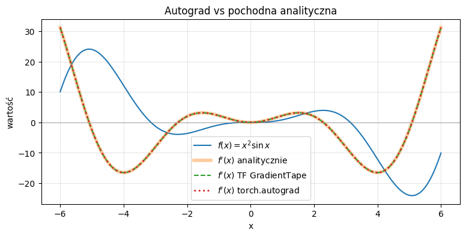

### Zadanie 2.1 - Gradient funkcji dwóch zmiennych w TF i PyTorch
- analitycznie: (0.27105, -0.65559)
- TF: (0.27105, -0.65559)
- PyTorch: (0.27105, -0.65559)

### Zadanie 2.2 - Sprawdzanie gradientu różnicami skończonymi (gradient check)
- błąd względny (h = 1e-5) = 1.47e-11

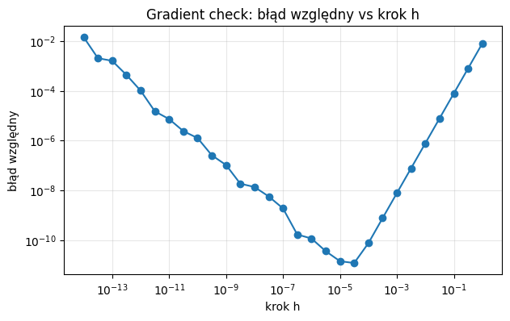

### 3. Regresja liniowa od zera
- GD: w = 2.5128, b = -1.0130, MSE = 0.9589
- `polyfit`: w = 2.5128, b = -1.0130

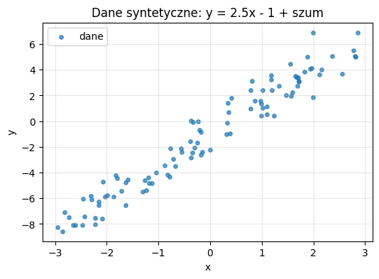

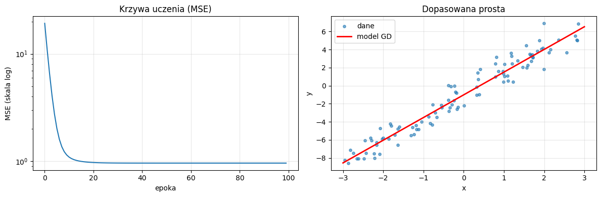

### 3.2 Powierzchnia straty i trajektoria spadku gradientu

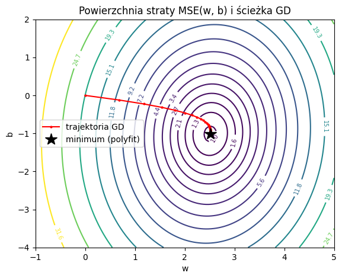

### 3.3 Prawdziwe dane: California Housing
- cechy: MedInc, HouseAge, AveRooms, AveBedrms, Population, AveOccup, Latitude, Longitude
- X: (2000, 8), y: (2000,); train: (1600, 8), test: (400, 8); standaryzacja na statystykach zbioru treningowego
- baseline (średnia): MSE test = 0.9137
- najmniejsze kwadraty (odniesienie): MSE train = 0.2818, test = 0.241

### Zadanie 3.1 - Wektorowy spadek gradientu w NumPy (wiele cech)
- GD (50 epok, lr = 0.2): czas 0.03 s, MSE train = 0.2829 vs optimum = 0.2818 (0.37%)
- MSE test GD = 0.2371
- `max|w_gd - w_ls| = 0.1456`

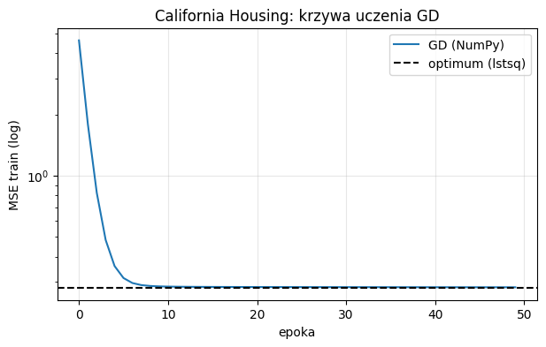

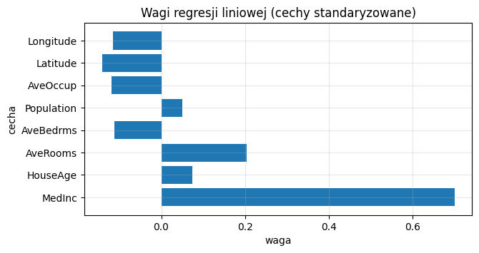

### 3.4 Ta sama regresja w PyTorch - najpierw "ręcznie" z autograd
- PyTorch (autograd): MSE train = 0.2829, `max|w_torch - w_ls| = 0.1456`

### 3.5 ...i w "standardowym" stylu PyTorch: `nn.Linear` + optymalizator
- `nn.Linear` + SGD: MSE train = 0.2859, test = 0.2344

### Zadanie 3.2 - Regresja liniowa w TensorFlow z `GradientTape`
- MSE train: NumPy 0.28288 | PyTorch 0.28288 | TF 0.28288

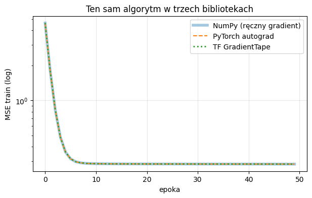

### Zadanie 4.1 - Eksperyment: za mały, dobry i za duży learning rate
- `lambda_min = 0.0480`, `lambda_max = 4.3339`, uwarunkowanie = 90.3
- `lr_kryt = 2/lambda_max = 0.4615`
- `lr = 0.4522` (0.98 * lr_kryt): zbieżność w 8 epokach do 1% od optimum
- `lr = 0.4846` (1.05 * lr_kryt): rozbieżność (MSE = 2.967) - hipoteza o progu `2/lambda_max` potwierdzona doświadczalnie

| lr | MSE po ostatniej epoce | epoki do 1% od optimum |
|---|---|---|
| 0.001 | 3.98 | nie osiągnięto |
| 0.01 | 1.155 | nie osiągnięto |
| 0.1 | 0.2837 | 24 |
| 0.2307 | 0.2830 | 10 |
| 0.4522 | 0.2824 | 8 |
| 0.4846 | 2.967 | nie osiągnięto |

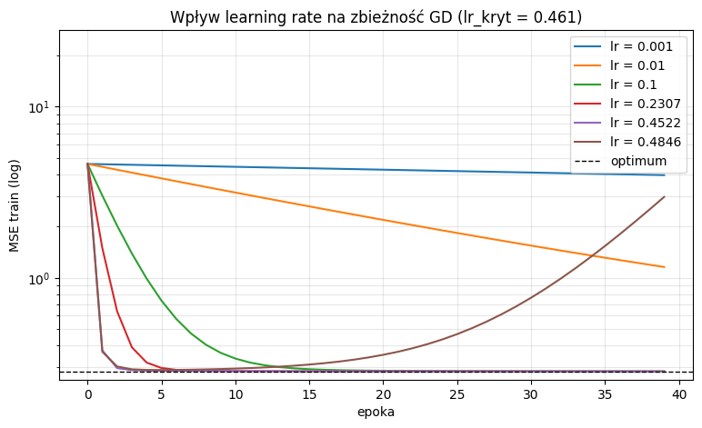

### Zadanie 5.1 - Implementacja mini-batch SGD i porównanie rozmiarów batcha
- 4 epoki, lr = 0.05
- B = 16: MSE = 0.3558
- B = 64: MSE = 0.2928
- B = 256: MSE = 0.2974
- full-batch: MSE = 2.1097 (przy tak małym lr i 4 epokach jeszcze daleko od zbieżności)

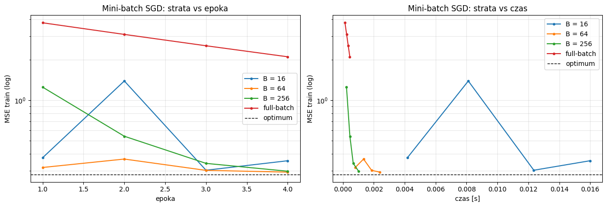

### 5.1 Mini-batche "po bibliotecznemu": `DataLoader` w PyTorch
- `DataLoader` + SGD (B = 64): MSE train = 0.4828

### 6. Regresja wielomianowa i przeuczenie (overfitting)

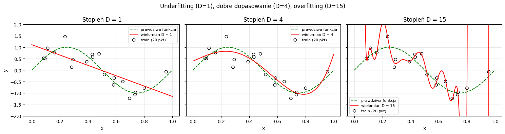

### Zadanie 6.1 - Krzywa train vs walidacja w funkcji stopnia wielomianu
- najlepszy stopień wg walidacji: D = 3, MSE val = 0.0911

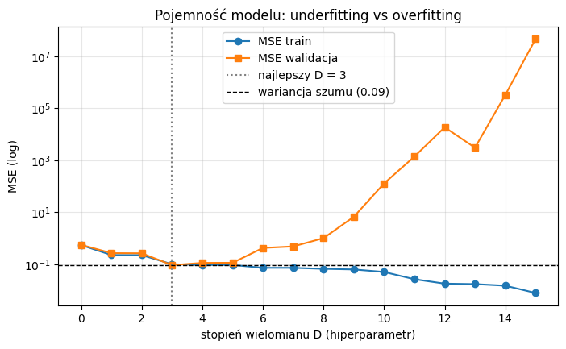

### Zadanie 6.2 - Regularyzacja L2 (ridge) jako "lekarstwo" na przeuczenie
- najlepsza `lambda = 3.16e-05`, MSE val = 0.1050

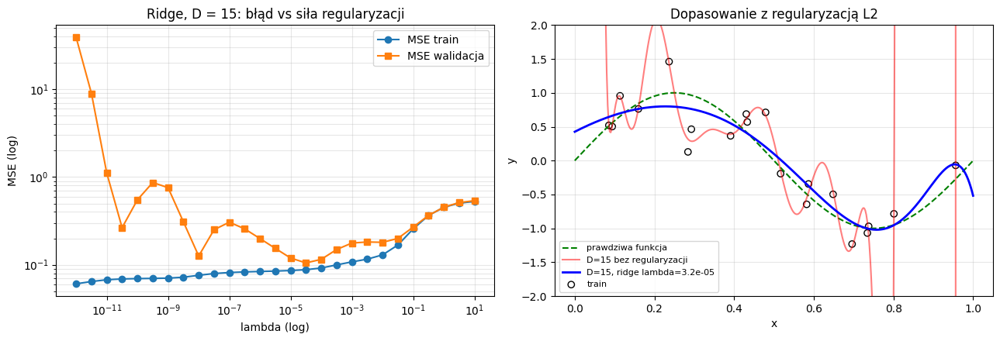

### Zadanie dodatkowe (dla chętnych) - GD, momentum i Adam na funkcji Rosenbrocka
- start (-1.5, 2), 300 kroków
- odległość od minimum (1,1): GD (lr=1e-3) = 2.314, momentum (lr=2e-4) = 2.046, Adam (lr=0.02) = 2.065
- momentum (lr=1e-3) = 0.384 (najbliżej minimum)

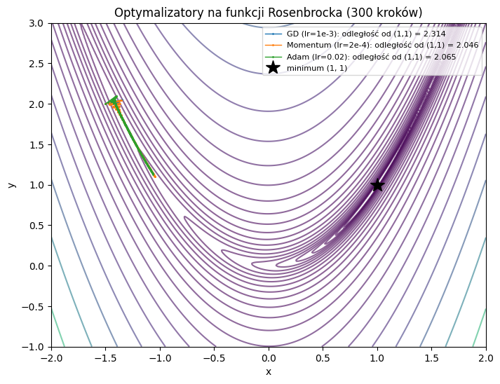

### Wnioski (Lab 01)
- Poprawność implementacji weryfikowano liczbowo: kontrolowano kształty i typy tensorów pośrednich, a ręcznie wyprowadzony gradient porównano z różnicami centralnymi w `float64` (błąd względny `1.5e-11`). Wektoryzowaną macierz odległości zestawiono z wersją pętlową - wyniki zgodne, a czas skrócony z 0.120 s do 0.00614 s (ok. 20x).
- Standaryzacja cech na statystykach zbioru treningowego poprawiła uwarunkowanie zadania (`cond = 90.3`), dzięki czemu GD z learning rate bliskim `lr_kryt` osiągał zbieżność w kilka epok.
- Learning rate okazał się najważniejszym hiperparametrem: wartości znacznie poniżej `lr_kryt` nie dawały zbieżności w zadanym budżecie epok, wartości w pobliżu `lr_kryt` dawały zbieżność najszybciej, a przekroczenie progu `2/lambda_max` prowadziło do rozbieżności - zgodnie z teorią dla straty kwadratowej.
- Pojemność modelu steruje kompromisem między niedouczeniem a przeuczeniem: krzywa walidacyjna ma minimum dla stopnia D = 3, a powyżej niego błąd walidacji rośnie przy wciąż malejącym błędzie treningowym. Stopień wybierano na zbiorze walidacyjnym, a zbiór testowy posłużył do jednorazowej oceny - błąd treningowy nie może być kryterium wyboru, ponieważ maleje monotonicznie wraz z pojemnością.
- Regularyzacja L2 poprawiła dopasowanie modelu o dużej pojemności (D = 15); optymalna wartość współczynnika wyniosła `lambda = 3.16e-05`.
- Przy stałym learning rate mini-batch SGD wykonywał więcej, tańszych kroków na epokę i szybciej zmniejszał błąd niż gradient pełny; trening na całym zbiorze okazał się w tym budżecie najwolniejszy.

## Lab 02

### 0. Środowisko i tryb pracy
- `SZYBKI_TRYB = False` (tryb pełny)
- NumPy 2.2.6, TensorFlow 2.21.0 / Keras 3.12.4, PyTorch 2.14.1+cpu
- GPU niewidoczne (`brak GPU`), `DEVICE = cpu`
- ustawione seedy: `SEED = 42` (Python, NumPy, TensorFlow, PyTorch)

### Zadanie 1.1 - Perceptron od zera w NumPy
- dane: 200 próbek `make_blobs`, 2 cechy, po 100 próbek w każdej klasie
- zbieżność po 2 epokach: błędy `[1, 0]`, dokładność = 1.000
- wyuczone parametry: `w = [0.196, 0.302]`, `b = -0.100`

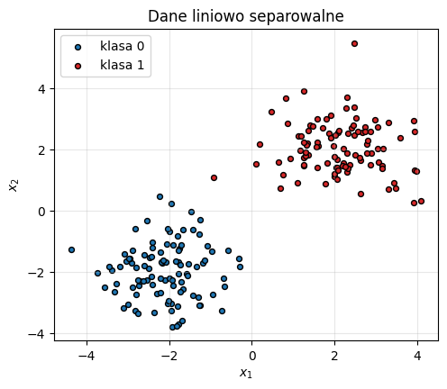

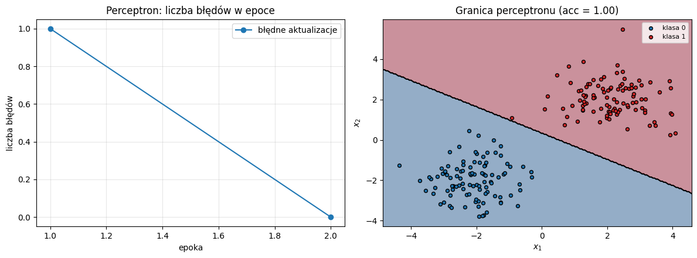

### Zadanie 1.2 - Porażka perceptronu na XOR
- XOR (4 punkty): dokładność = 0.50, błędy w ostatnich epokach `[1, 2, 2, 4, 2]` - nie znikają
- XOR zaszumiony (400 punktów): dokładność = 0.53
- perceptron może narysować tylko jedną prostą, a klasy XOR leżą naprzemiennie na przekątnych kwadratu - żadna prosta ich nie rozdziela

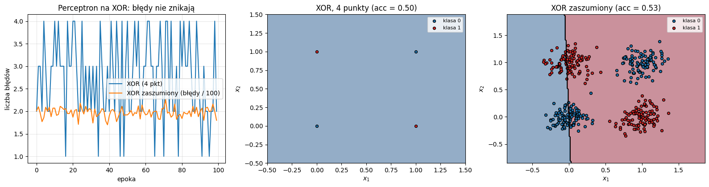

### Zadanie 2.1 - Pochodne funkcji aktywacji: ręcznie vs autograd
- maksymalne różnice względem autogradu PyTorch (`float64`): sigmoid `5.55e-17`, tanh `2.70e-16`, ReLU `0`, LeakyReLU `0`, GELU `2.22e-16`
- wszystkie różnice < 1e-6 - implementacje pochodnych poprawne
- maksimum pochodnej sigmoidu wynosi 0.25 (w `z = 0`); sigmoid i tanh nasycają się dla `|z| > 4`

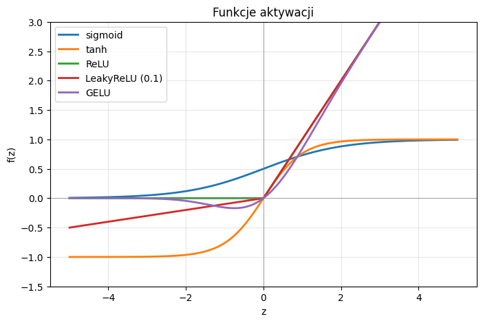

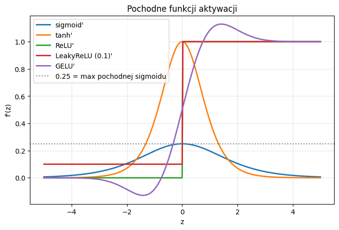

### Zadanie 2.2 - Znikający gradient w 20-warstwowej sieci
- sigmoid: `|grad|` warstwy 1 = `2.47e-13`, warstwy ostatniej = `3.27`, stosunek = `7.5e-14`
- tanh: `1.51e-01` -> `2.67e-01`, stosunek = `5.6e-01`
- ReLU (He): `3.52e-01` -> `2.55e-01`, stosunek = `1.4`
- gradient sigmoidu maleje o ok. 13 rzędów wielkości w stronę wejścia; dla ReLU pozostaje stabilny - hipoteza potwierdzona

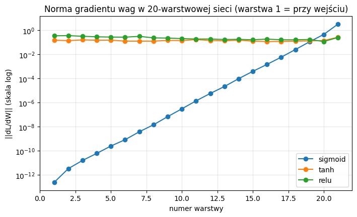

### Zadanie 3.1 - Ręczny backprop i trening MLP na XOR
- architektura 2-4-1, łącznie 17 parametrów
- strata BCE przed treningiem = 0.6712, po 5000 epokach = 0.00047
- predykcje: `[0.000, 0.999, 0.999, 0.001]` -> `[0, 1, 1, 0]` (zgodne z celem)
- granica decyzyjna oddziela przekątne kwadratu

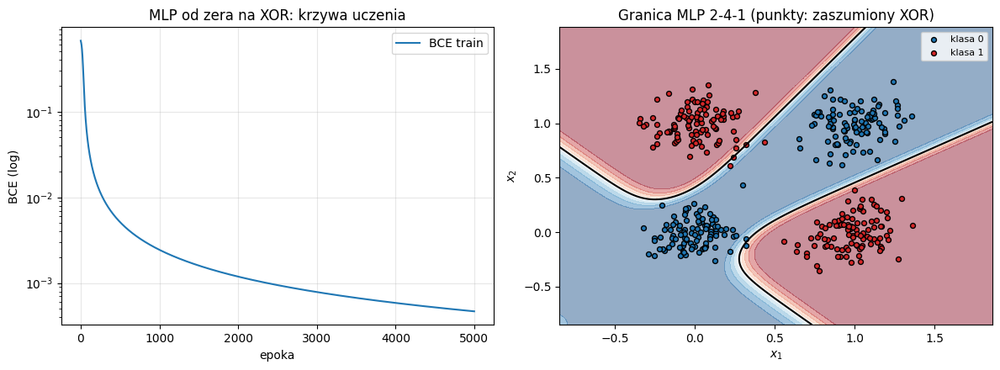

### Zadanie 3.2 - Gradient check ręcznego backpropu
- błędy względne (`h = 1e-5`): `W1 = 7.77e-11`, `b1 = 2.91e-11`, `W2 = 2.96e-11`, `b2 = 2.70e-11`
- wszystkie < 1e-7 - backprop zgodny z różnicami centralnymi

### Zadanie 4.1 - Ręczne liczenie liczby parametrów
- `model_seq` [2, 16, 16, 1]: ręcznie `[48, 272, 17]`, suma 337; Keras `[48, 272, 17]`, 337
- `model_duzy` [2, 64, 32, 8, 1]: ręcznie `[192, 2080, 264, 9]`, suma 2545; Keras identycznie
- `Dense(512)` na spłaszczonym obrazie 28x28: `(784 + 1) * 512 = 401920` parametrów

### 4.2 MLP w Keras: Sequential API (`make_moons`)
- dane: 750 próbek treningowych, 250 walidacyjnych (`noise = 0.2`)
- model 2-16-16-1, Adam (lr = 0.01), 150 epok, batch 32
- czas treningu 17.3 s; walidacja: BCE = 0.0460, dokładność = 0.9800
- krzywe train/walidacja blisko siebie, brak silnego przeuczenia; granica gładko podąża za półksiężycami

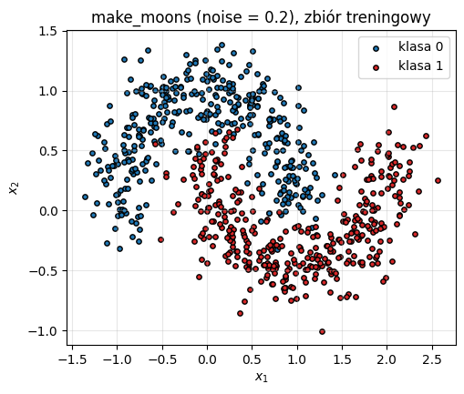

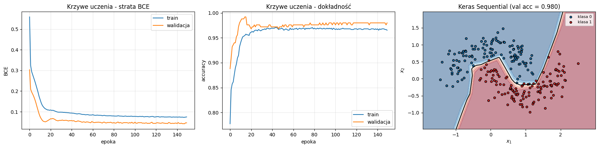

### Zadanie 4.2 - Functional API (`make_circles`)
- model 2-16-8-1 z aktywacją tanh, Adam (lr = 0.01), 150 epok
- dokładność walidacyjna = 0.9880; granica decyzyjna ma kształt zbliżony do okręgu

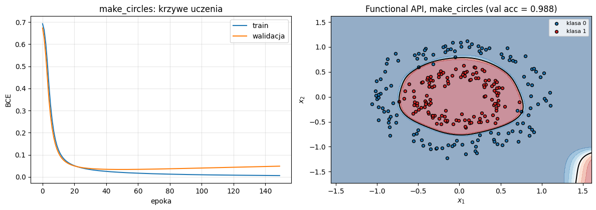

### Zadanie 5.1 - Ten sam MLP w PyTorch
- klasa `MLP` (2-16-16-1) ma 337 parametrów - tyle samo co model Keras
- `BCEWithLogitsLoss` na logitach, Adam (lr = 0.01), 150 epok, `DataLoader` (batch 32)
- czas treningu 4.4 s; walidacja: BCE = 0.0356, dokładność = 0.9880
- wynik porównywalny z Keras (0.9800); krzywe uczenia mają podobny przebieg

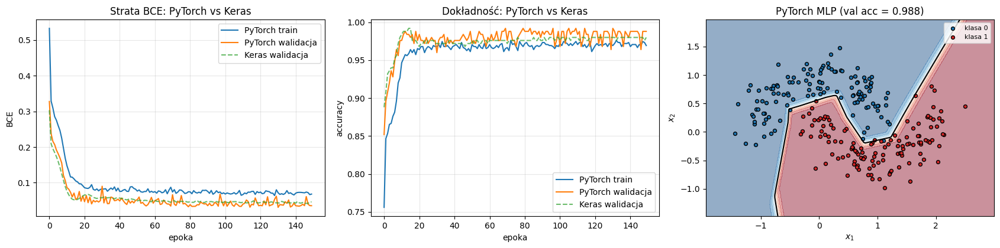

### Zadanie 6.1 - Pojemność sieci a granica decyzyjna
- dane: 200 próbek treningowych i 1000 walidacyjnych, `make_moons` z `noise = 0.3`
- trening full-batch, Adam (lr = 0.01), 2000 kroków

| warstwy x neurony | parametry | train acc | val acc |
|---|---:|---:|---:|
| 1 x 2 | 9 | 0.850 | 0.851 |
| 1 x 8 | 33 | 0.925 | **0.910** |
| 1 x 64 | 257 | 0.950 | 0.900 |
| 2 x 2 | 15 | 0.925 | 0.904 |
| 2 x 8 | 105 | 0.935 | 0.899 |
| 2 x 64 | 4417 | 1.000 | 0.891 |
| 3 x 2 | 21 | 0.875 | 0.848 |
| 3 x 8 | 177 | 0.970 | 0.887 |
| 3 x 64 | 8577 | 0.995 | 0.892 |

- najlepsza architektura wg walidacji: **1 warstwa x 8 neuronów**, val acc = 0.910
- sieć 1 x 2 daje prawie liniową granicę (niedouczenie), a duże modele (2 x 64, 3 x 64) osiągają train acc 1.00 przy val ok. 0.89 (przeuczenie)

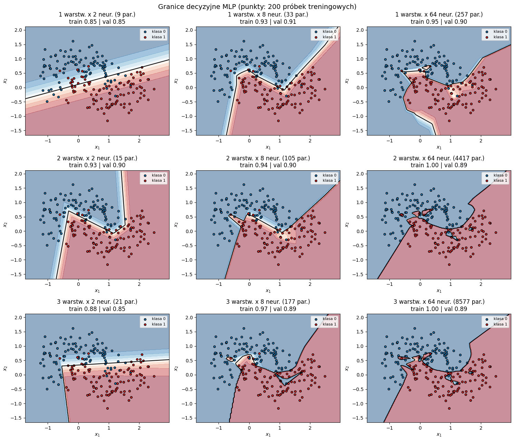

### Zadanie dodatkowe - Uniwersalny MLP w NumPy (spirala)
- sieć [2, 64, 64, 3], ReLU + stabilny softmax, full-batch, lr = 0.5, 5000 iteracji
- dokładność treningowa = 0.993, końcowa entropia krzyżowa = 0.0169
- granice decyzyjne trzech klas podążają za ramionami spiral

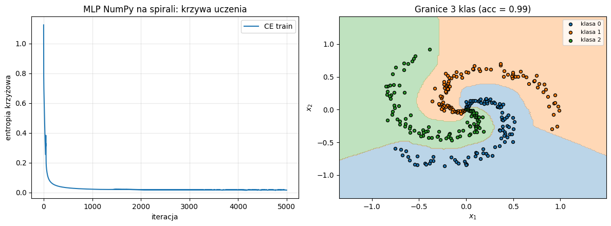

### Wnioski (Lab 02)
- Perceptron uczy się tylko danych liniowo separowalnych: na `make_blobs` osiągnął 100% po 2 epokach, a na XOR utknął na 50-53%, mimo 100 epok. To potwierdza geometryczne ograniczenie pojedynczej hiperpłaszczyzny i potrzebę warstwy ukrytej.
- Nieliniowa aktywacja jest niezbędna: dopiero MLP 2-4-1 z tanh nauczył się XOR (BCE 0.00047, predykcje `[0, 1, 1, 0]`). Ręcznie wyprowadzony backprop zweryfikowano gradient checkiem - błędy względne rzędu `1e-11`.
- Eksperyment z 20 warstwami potwierdził znikający gradient: dla sigmoidu norma gradientu pierwszej warstwy była ok. `7.5e-14` razy mniejsza niż ostatniej, dla tanh stosunek wynosił 0.56, a dla ReLU z inicjalizacją He - 1.4. ReLU i inicjalizacja He są praktycznym standardem w głębokich sieciach.
- Implementacje NumPy, Keras i PyTorch są spójne: liczba parametrów zgadza się co do jednego (337 dla 2-16-16-1, 2545 dla 2-64-32-8-1), a modele Keras i PyTorch osiągnęły zbliżoną dokładność walidacyjną (0.980 vs 0.988).
- Pojemność steruje kompromisem niedouczenie/przeuczenie: zbyt mała sieć (1 x 2) ma granicę prawie liniową, a duże modele na 200 próbkach przeuczają się (train 1.00, val ok. 0.89). Architekturę wybrano na zbiorze walidacyjnym - najlepsza okazała się 1 x 8 (val 0.910), a nie największa sieć.
- Zadanie dodatkowe pokazało, że ręczny backprop uogólnia się na wiele klas i dowolną liczbę warstw: sieć NumPy [2, 64, 64, 3] osiągnęła 99.3% na spirali, bez użycia autogradu.

## Lab 03

## Lab 04

## Lab 05

## Lab 06

## Lab 07
